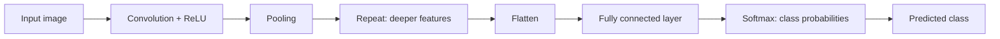

**In simple words:** image classification with a CNN means turning the picture into numbers, finding features with convolution and pooling, and then letting fully connected layers and softmax name the class. <Cite id="class-dl-qb2" loc="Q4" />

**Steps of image classification (for example cats versus dogs)** <Cite id="class-dl-chp4" loc="slide 28" /> <Cite id="class-dl-m4" loc="p. 88" /> <Cite id="class-dl-m4" loc="p. 89" />

1. **Input image:** the computer sees a grid of numbers, one per pixel; an RGB image has 3 channels (for example 32×32×3). <Cite id="class-dl-chp4" loc="slide 2" />
2. **Convolution + ReLU:** filters (small matrices of learnable weights) slide over the image and give feature maps; early filters find edges. Output size $\lfloor (N - F + 2P)/S \rfloor + 1$.
3. **Pooling:** max pooling shrinks each feature map, keeping the strongest values. The number of channels is the number of filters.
4. **Repeat** convolution and pooling: deeper layers find curves, shapes, object parts and the complete object.
5. **Flatten:** the final feature maps become a 1D vector (5×5×64 gives 1600).
6. **Fully connected layer:** combines the learned features.
7. **Softmax:** gives class probabilities (Cat 0.10, Dog 0.80, Horse 0.10); the highest is the predicted class, Dog.
8. **Training:** prediction → loss → backpropagation → the filter weights are updated; nobody sets the filters by hand. <Cite id="class-dl-chp4" loc="slide 8" />

**Object detection.** The class files list object detection as an application of CNNs beside image classification, but they do not give a separate list of steps for it. The feature-finding steps 1 to 4 are the same; the difference is that the network must say which object is present (and in which part of the picture) instead of giving one label for the whole image. <Cite id="class-dl-m4" loc="p. 87" /> <Cite id="class-dl-chp4" loc="slide 67" />

**Conclusion:** classification = pixels → convolution and pooling (features) → flatten → fully connected → softmax → class.
