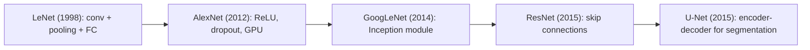

**In simple words:** in paanchon networks ne CNNs mein ek-ek idea joda: LeNet ne dikhaya ki CNN features seekh sakta hai, AlexNet ne ReLU aur GPUs se use deep banaya, GoogLeNet ne alag-alag size ke filters saath-saath chalaye, ResNet ne skip connections jode, aur U-Net har pixel ko label karta hai. <Cite id="class-dl-qb2" loc="Q4" />

**LeNet-5.** Handwritten digits ke liye. Input 32×32×1; C1 (6 filters 5×5) 28×28×6, S2 pooling 14×14×6, C3 (16 filters) 10×10×16, S4 5×5×16, C5 (120 filters) 1×1×120, F6 84, output 10. Paanch trainable layers, tanh, lagbhag 60 hazaar parameters. Analysis: features khud seekhne wala pehla CNN, lekin low capacity. <Cite id="class-dl-chp4" loc="slide 45" /> <Cite id="class-dl-m4" loc="p. 51" />

**AlexNet.** Input 227×227×3; 5 convolution aur 3 fully connected layers (55×55×96 → 27×27×96 → 27×27×256 → 13×13×256 → 13×13×384 → 13×13×384 → 13×13×256 → 6×6×256 → 4096 → 4096 → 1000). ReLU, max pooling, dropout 0.5, data augmentation, GPUs; lagbhag 62 million parameters. Analysis: ImageNet 2012 jeeta, lekin parameters bahut. <Cite id="class-dl-chp4" loc="slide 48" /> <Cite id="class-dl-m4" loc="p. 60" />

**GoogLeNet.** 22 layers, ILSVRC 2014 ka winner. **Inception module** 1×1, 3×3, 5×5 convolutions aur 3×3 max pooling ko parallel chalata hai aur outputs stack karta hai; 1×1 convolutions computation kam karte hain (class example mein 112.9 million operations 5.3 million reh jaate hain); **global average pooling** fully connected layers ki jagah leta hai; auxiliary classifiers training mein madad karte hain. Lagbhag 6.8 million parameters. Analysis: efficient, lekin complex. <Cite id="class-dl-m4" loc="p. 64" /> <Cite id="class-dl-m4" loc="p. 67" />

**ResNet.** Skip connection $y = F(x) + x$ deta hai, jo bahut deep networks ki degradation problem fix karta hai; 18 se 152 layers ke versions; shortcut par 1×1 convolution sizes match karta hai. ResNet-50 ke 25.6 million parameters. Analysis: bahut deep networks train karta hai, high resolution par ab bhi heavy. <Cite id="class-dl-chp4" loc="slide 49" /> <Cite id="class-dl-m4" loc="p. 77" />

**U-Net.** Segmentation ke liye U-shaped fully convolutional encoder-decoder. Encoder size aadha aur filters double karta hai (har block mein do 3×3 convolutions + 2×2 max pooling); decoder size double karta hai (2×2 transpose convolution, encoder map ke saath concatenation, do 3×3 convolutions); skip connections detail le jaate hain; sigmoid ke saath 1×1 convolution mask deta hai. Analysis: limited data ke saath achha, plain classification ke liye nahi. <Cite id="class-dl-m4" loc="p. 83" /> <Cite id="class-dl-m4" loc="p. 84" />

**Conclusion:** LeNet ki simplicity se U-Net ki specialization tak, har design ne apne waqt ki ek problem solve ki. <Cite id="class-dl-m4" loc="p. 86" />
