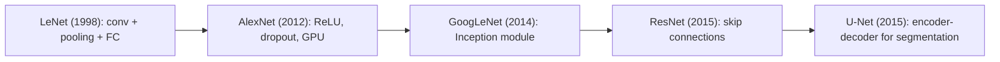

**In simple words:** each of these five networks added one idea to CNNs: LeNet showed that a CNN can learn features, AlexNet made it deep with ReLU and GPUs, GoogLeNet ran filters of different sizes side by side, ResNet added skip connections, and U-Net labels every pixel. <Cite id="class-dl-qb2" loc="Q4" />

**LeNet-5.** For handwritten digits. Input 32×32×1; C1 (6 filters 5×5) 28×28×6, S2 pooling 14×14×6, C3 (16 filters) 10×10×16, S4 5×5×16, C5 (120 filters) 1×1×120, F6 84, output 10. Five trainable layers, tanh, about 60 thousand parameters. Analysis: first CNN to learn features automatically, but low capacity. <Cite id="class-dl-chp4" loc="slide 45" /> <Cite id="class-dl-m4" loc="p. 51" />

**AlexNet.** Input 227×227×3; 5 convolution and 3 fully connected layers (55×55×96 → 27×27×96 → 27×27×256 → 13×13×256 → 13×13×384 → 13×13×384 → 13×13×256 → 6×6×256 → 4096 → 4096 → 1000). ReLU, max pooling, dropout 0.5, data augmentation, GPUs; about 62 million parameters. Analysis: won ImageNet 2012, but many parameters. <Cite id="class-dl-chp4" loc="slide 48" /> <Cite id="class-dl-m4" loc="p. 60" />

**GoogLeNet.** 22 layers, winner of ILSVRC 2014. The **Inception module** runs 1×1, 3×3, 5×5 convolutions and 3×3 max pooling in parallel and stacks the outputs; 1×1 convolutions reduce computation (112.9 million operations fall to 5.3 million in the class example); **global average pooling** replaces fully connected layers; auxiliary classifiers help training. About 6.8 million parameters. Analysis: efficient, but complex. <Cite id="class-dl-m4" loc="p. 64" /> <Cite id="class-dl-m4" loc="p. 67" />

**ResNet.** Skip connection gives $y = F(x) + x$, which fixes the degradation problem of very deep networks; versions of 18 to 152 layers; a 1×1 convolution matches sizes on the shortcut. ResNet-50 has 25.6 million parameters. Analysis: trains extremely deep networks, still heavy at high resolution. <Cite id="class-dl-chp4" loc="slide 49" /> <Cite id="class-dl-m4" loc="p. 77" />

**U-Net.** A U-shaped fully convolutional encoder-decoder for segmentation. The encoder halves the size and doubles the filters (two 3×3 convolutions + 2×2 max pooling per block); the decoder doubles the size (2×2 transpose convolution, concatenation with the encoder map, two 3×3 convolutions); skip connections carry detail; a 1×1 convolution with sigmoid gives the mask. Analysis: good with limited data, not meant for plain classification. <Cite id="class-dl-m4" loc="p. 83" /> <Cite id="class-dl-m4" loc="p. 84" />

**Conclusion:** from LeNet's simplicity to U-Net's specialization, each design solved one problem of its time. <Cite id="class-dl-m4" loc="p. 86" />
