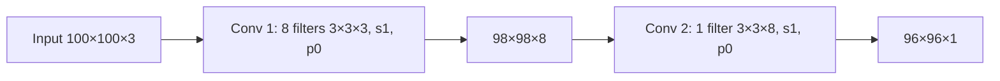

**In simple words:** har convolution layer utne feature maps deti hai jitne uske filters hain, aur har filter utna deep hona chahiye jitna layer ka input. Isliye doosri layer ka filter 3×3×8 hai, 3×3×3 nahi. <Cite id="class-dl-qb2" loc="Q4" />

**Formulas** <Cite id="class-dl-chp4" loc="slide 54" />

- Output height aur width: $\lfloor (N + 2P - F)/S \rfloor + 1$. Output depth = filters ki sankhya $K$.
- Parameters (bias ke saath): $(F \times F \times D + 1) \times K$, jahan $D$ input depth hai.

<Sum>

<Given>

input 100×100×3. Layer 1: 3×3 ke 8 filters, stride 1, padding 0. Layer 2: 3×3 ka 1 filter, stride 1, padding 0.

</Given>

<Find>

(1) layer 1 ka output, (2) uske parameters bias ke saath, (3) layer 2 ka output, (4) uske parameters bias ke saath, (5) total, (6) interpretation.

</Find>

<Steps>

1. **Layer 1 output:** $(100 - 3)/1 + 1 = 98$; depth = 8 filters, to **98×98×8**.
2. **Layer 1 parameters:** har filter 3×3×3 hai, to $(3 \cdot 3 \cdot 3 + 1) \times 8 = 28 \times 8 = 224$.
3. **Layer 2 output:** input ab 98×98×8 hai, to $(98 - 3)/1 + 1 = 96$; depth = 1 filter, to **96×96×1**.
4. **Layer 2 parameters:** har filter 3×3×8 hona chahiye (depth naye input depth ke barabar), to $(3 \cdot 3 \cdot 8 + 1) \times 1 = 73$.
5. **Total:** $224 + 73 = 297$.

</Steps>

<Answer>

(1) 98×98×8; (2) 224; (3) 96×96×1; (4) 73; (5) 297 trainable parameters.

</Answer>

<Box kind="verify">

Padding ke bina har 3×3 convolution height aur width se 2 ghatata hai: $100 \to 98 \to 96$. Doosre filter ke $3 \times 3 \times 8 = 72$ weights plus 1 bias $= 73$, aur pehle ke har filter ke $27 + 1 = 28$, $28 \times 8 = 224$. Dono class sheet se match karte hain.

</Box>

</Sum>

**Interpretation** (6): height aur width ghatte hain (100 → 98 → 96) kyunki padding nahi hai, isliye har 3×3 filter har side se ek pixel kho deta hai. Output depth filters ki sankhya ke barabar hai (8, phir 1), kyunki har filter ek feature map banata hai. Parameter count filter size, input depth aur filters ki sankhya par depend karta hai, image size par nahi; layer 2 ke parameters kam (73) hain kyunki usme sirf ek filter hai. <Cite id="class-dl-chp4" loc="slide 54" />

**Conclusion:** dono layers 98×98×8 aur 96×96×1 deti hain, total 297 trainable parameters ke saath.
