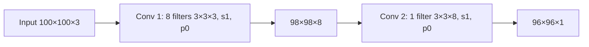

**In simple words:** each convolution layer gives as many feature maps as it has filters, and each filter must be as deep as the layer's input. So the second layer's filter is 3×3×8, not 3×3×3. <Cite id="class-dl-qb2" loc="Q4" />

**Formulas** <Cite id="class-dl-chp4" loc="slide 54" />

- Output height and width: $\lfloor (N + 2P - F)/S \rfloor + 1$. Output depth = number of filters $K$.
- Parameters (with bias): $(F \times F \times D + 1) \times K$, where $D$ is the input depth.

<Sum>

<Given>

input 100×100×3. Layer 1: 8 filters of 3×3, stride 1, padding 0. Layer 2: 1 filter of 3×3, stride 1, padding 0.

</Given>

<Find>

(1) output of layer 1, (2) its parameters with bias, (3) output of layer 2, (4) its parameters with bias, (5) the total, (6) the interpretation.

</Find>

<Steps>

1. **Layer 1 output:** $(100 - 3)/1 + 1 = 98$; depth = 8 filters, so **98×98×8**.
2. **Layer 1 parameters:** each filter is 3×3×3, so $(3 \cdot 3 \cdot 3 + 1) \times 8 = 28 \times 8 = 224$.
3. **Layer 2 output:** the input is now 98×98×8, so $(98 - 3)/1 + 1 = 96$; depth = 1 filter, so **96×96×1**.
4. **Layer 2 parameters:** each filter must be 3×3×8 (depth equals the new input depth), so $(3 \cdot 3 \cdot 8 + 1) \times 1 = 73$.
5. **Total:** $224 + 73 = 297$.

</Steps>

<Answer>

(1) 98×98×8; (2) 224; (3) 96×96×1; (4) 73; (5) 297 trainable parameters.

</Answer>

<Box kind="verify">

Each 3×3 convolution with no padding removes 2 from height and width: $100 \to 98 \to 96$. The second filter has $3 \times 3 \times 8 = 72$ weights plus 1 bias $= 73$, and the first has $27 + 1 = 28$ per filter, $28 \times 8 = 224$. Both match the class sheet.

</Box>

</Sum>

**Interpretation** (6): the height and width shrink (100 → 98 → 96) because there is no padding, so each 3×3 filter loses one pixel on every side. The output depth equals the number of filters (8, then 1), since every filter makes one feature map. The parameter count depends on the filter size, the input depth and the number of filters, not on the image size; layer 2 has few parameters (73) because it has only one filter. <Cite id="class-dl-chp4" loc="slide 54" />

**Conclusion:** the two layers give 98×98×8 and 96×96×1 with 297 trainable parameters in all.
