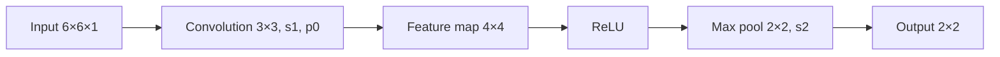

**In simple words:** 3×3 filter ko 6×6 image par slide karo to 4×4 map milta hai, ReLU se negatives 0 karo, phir har 2×2 block ka sabse bada number rakho. Filter ki teen barabar rows (1, 0, −1) hain, isliye wo poochta hai "is patch ka left side right side se zyada bright hai?" <Cite id="class-dl-qb2" loc="Q4" />

<Sum>

<Given>

input 6×6×1, filter 3×3 jiski rows (1, 0, −1) hain, stride 1, padding 0, phir ReLU, phir stride 2 ke saath 2×2 max pooling.

$$
\text{Input} = \begin{bmatrix} 3 & 0 & 1 & 2 & 1 & 0 \\ 1 & 2 & 4 & 3 & 1 & 2 \\ 0 & 1 & 3 & 5 & 3 & 1 \\ 2 & 3 & 6 & 4 & 2 & 1 \\ 1 & 2 & 4 & 3 & 1 & 0 \\ 0 & 1 & 2 & 2 & 1 & 1 \end{bmatrix}
$$

</Given>

<Find>

(a) output size, (b) 4×4 feature map, (c) ReLU ke baad, (d) max pooling ke baad, (e) parameters, (f) interpretation.

</Find>

<Steps>

1. **(a) Values:** $W_1 = 6$, $H_1 = 6$, $D_1 = 1$, $F = 3$, $S = 1$, $P = 0$, $K = 1$. $W_2 = (6 - 3 + 0)/1 + 1 = 4$, $H_2 = 4$, $D_2 = K = 1$. Output **4×4×1**.
2. **(b) Map ki ek value:** kyunki har filter row (1, 0, −1) hai, kisi position ki value $\sum_{3\text{ rows}} (\text{left pixel} - \text{right pixel})$ hoti hai. Top-left region (rows 1 se 3, columns 1 se 3): $(3 - 1) + (1 - 4) + (0 - 3) = 2 - 3 - 3 = -4$.
3. **Agli value** (columns 2 se 4): $(0 - 2) + (2 - 3) + (1 - 5) = -2 - 1 - 4 = -7$. Phir (columns 3 se 5): $(1 - 1) + (4 - 1) + (3 - 3) = 0 + 3 + 0 = 3$. Phir (columns 4 se 6): $(2 - 0) + (3 - 2) + (5 - 1) = 2 + 1 + 4 = 7$.
4. **Baaki rows** isi tarah poora feature map deti hain:

   $$
   \begin{bmatrix} -4 & -7 & 3 & 7 \\ -10 & -6 & 7 & 8 \\ -10 & -6 & 7 & 10 \\ -9 & -3 & 8 & 7 \end{bmatrix}
   $$
5. **(c) ReLU** (negative 0 ho jaata hai, positive waisa hi):

   $$
   \begin{bmatrix} 0 & 0 & 3 & 7 \\ 0 & 0 & 7 & 8 \\ 0 & 0 & 7 & 10 \\ 0 & 0 & 8 & 7 \end{bmatrix}
   $$
6. **(d) Max pooling 2×2, stride 2:** size $(4 - 2)/2 + 1 = 2$. Top-left block (0, 0, 0, 0) se 0; top-right (3, 7, 7, 8) se 8; bottom-left (0, 0, 0, 0) se 0; bottom-right (7, 10, 8, 7) se 10.
7. **(e) Parameters:** $(3 \cdot 3 \cdot 1 + 1) \times 1 = 10$ (9 weights + 1 bias).

</Steps>

<Answer>

(a) 4×4×1; (b) upar ka map; (c) upar ka ReLU map; (d) $\begin{bmatrix} 0 & 8 \\ 0 & 10 \end{bmatrix}$; (e) 10 parameters.

</Answer>

<Box kind="verify">

Ek value alag tareeke se check karo: bottom-right entry rows 4 se 6, columns 4 se 6 use karti hai, $\begin{bmatrix} 4 & 2 & 1 \\ 3 & 1 & 0 \\ 2 & 1 & 1 \end{bmatrix}$; filter deta hai $(4 - 1) + (3 - 0) + (2 - 1) = 3 + 3 + 1 = 7$, table jaisa hi. Pooled outputs apne block ke sabse bade numbers hain (8 aur 10).

</Box>

</Sum>

**(f) Interpretation.** Filter (har row mein 1, 0, −1) ek vertical-edge detector hai: bada positive value matlab patch ka left part right part se zyada bright hai, aur negative matlab ulta. ReLU ke baad sirf positive responses bachte hain; output ka left half 0 hai aur right half mein strong responses hain (3, 7, 7, 8, 7, 10, 8, 7). Max pooling har block ka sabse strong response rakhta hai aur size aadha karta hai, isliye right side ke 8 aur 10 dikhate hain ki ye edge kahan sabse strong hai. Size 6×6 se 4×4 se 2×2 ho gaya aur sirf 10 parameters chahiye. <Cite id="class-dl-chp4" loc="slide 6" /> <Cite id="class-dl-chp4" loc="slide 32" />

**Conclusion:** 6×6 image 4×4 feature map banti hai, phir ReLU map, phir final 2×2 output $\begin{bmatrix} 0 & 8 \\ 0 & 10 \end{bmatrix}$.
