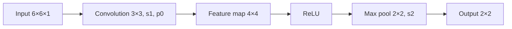

**In simple words:** slide the 3×3 filter over the 6×6 image to get a 4×4 map, turn negatives into 0 with ReLU, then keep the largest number of every 2×2 block. The filter has three equal rows (1, 0, −1), so it answers "is the left side of this patch brighter than the right side?" <Cite id="class-dl-qb2" loc="Q4" />

<Sum>

<Given>

input 6×6×1, filter 3×3 with rows (1, 0, −1), stride 1, padding 0, then ReLU, then 2×2 max pooling with stride 2.

$$
\text{Input} = \begin{bmatrix} 3 & 0 & 1 & 2 & 1 & 0 \\ 1 & 2 & 4 & 3 & 1 & 2 \\ 0 & 1 & 3 & 5 & 3 & 1 \\ 2 & 3 & 6 & 4 & 2 & 1 \\ 1 & 2 & 4 & 3 & 1 & 0 \\ 0 & 1 & 2 & 2 & 1 & 1 \end{bmatrix}
$$

</Given>

<Find>

(a) the output size, (b) the 4×4 feature map, (c) after ReLU, (d) after max pooling, (e) the parameters, (f) the interpretation.

</Find>

<Steps>

1. **(a) Values:** $W_1 = 6$, $H_1 = 6$, $D_1 = 1$, $F = 3$, $S = 1$, $P = 0$, $K = 1$. $W_2 = (6 - 3 + 0)/1 + 1 = 4$, $H_2 = 4$, $D_2 = K = 1$. Output **4×4×1**.
2. **(b) One value of the map:** because each filter row is (1, 0, −1), the value at a position is $\sum_{3\text{ rows}} (\text{left pixel} - \text{right pixel})$. Top-left region (rows 1 to 3, columns 1 to 3): $(3 - 1) + (1 - 4) + (0 - 3) = 2 - 3 - 3 = -4$.
3. **Next value** (columns 2 to 4): $(0 - 2) + (2 - 3) + (1 - 5) = -2 - 1 - 4 = -7$. Then (columns 3 to 5): $(1 - 1) + (4 - 1) + (3 - 3) = 0 + 3 + 0 = 3$. Then (columns 4 to 6): $(2 - 0) + (3 - 2) + (5 - 1) = 2 + 1 + 4 = 7$.
4. **The other rows,** in the same way, give the full feature map:

   $$
   \begin{bmatrix} -4 & -7 & 3 & 7 \\ -10 & -6 & 7 & 8 \\ -10 & -6 & 7 & 10 \\ -9 & -3 & 8 & 7 \end{bmatrix}
   $$
5. **(c) ReLU** (negative becomes 0, positive stays):

   $$
   \begin{bmatrix} 0 & 0 & 3 & 7 \\ 0 & 0 & 7 & 8 \\ 0 & 0 & 7 & 10 \\ 0 & 0 & 8 & 7 \end{bmatrix}
   $$
6. **(d) Max pooling 2×2, stride 2:** size $(4 - 2)/2 + 1 = 2$. Top-left block (0, 0, 0, 0) gives 0; top-right (3, 7, 7, 8) gives 8; bottom-left (0, 0, 0, 0) gives 0; bottom-right (7, 10, 8, 7) gives 10.
7. **(e) Parameters:** $(3 \cdot 3 \cdot 1 + 1) \times 1 = 10$ (9 weights + 1 bias).

</Steps>

<Answer>

(a) 4×4×1; (b) the map above; (c) the ReLU map above; (d) $\begin{bmatrix} 0 & 8 \\ 0 & 10 \end{bmatrix}$; (e) 10 parameters.

</Answer>

<Box kind="verify">

Check one value in a different way: the bottom-right entry uses rows 4 to 6, columns 4 to 6, $\begin{bmatrix} 4 & 2 & 1 \\ 3 & 1 & 0 \\ 2 & 1 & 1 \end{bmatrix}$; the filter gives $(4 - 1) + (3 - 0) + (2 - 1) = 3 + 3 + 1 = 7$, the same as the table. The pooled outputs are the largest numbers of their blocks (8 and 10), and every pooled number is at least as large as the others in its block.

</Box>

</Sum>

**(f) Interpretation.** The filter (1, 0, −1 in every row) is a vertical-edge detector: a large positive value means the left part of the patch is brighter than the right part, and a negative value means the opposite. After ReLU only the positive responses stay; the left half of the output is 0 and the right half has the strong responses (3, 7, 7, 8, 7, 10, 8, 7). Max pooling keeps the strongest response of each block and halves the size, so 8 and 10 on the right side show where this edge is strongest. The size fell from 6×6 to 4×4 to 2×2 and needs only 10 parameters. <Cite id="class-dl-chp4" loc="slide 6" /> <Cite id="class-dl-chp4" loc="slide 32" />

**Conclusion:** the 6×6 image becomes a 4×4 feature map, then a ReLU map, then a final 2×2 output $\begin{bmatrix} 0 & 8 \\ 0 & 10 \end{bmatrix}$.
