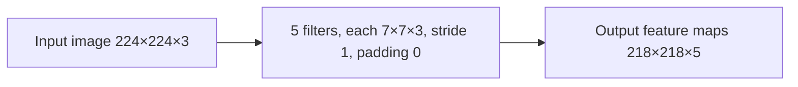

**In simple words:** height aur width isliye ghatte hain kyunki 7×7 filter ko image ke andar fit hona hai, aur depth 5 ho jaati hai kyunki har filter ek feature map banata hai. Parameters 5 filters ke weights ginte hain jo har ek teeno colour channels cover karta hai. <Cite id="class-dl-qb2" loc="Q4" />

**Formulas** <Cite id="class-dl-chp4" loc="slide 60" /> <Cite id="class-dl-chp4" loc="slide 66" />

- Output size: $\lfloor (N - F + 2P)/S \rfloor + 1$; output depth $= K$.
- Bias ke saath parameters: $(F \times F \times D + 1) \times K$. Stride aur padding use nahi hote.

<Sum>

<Given>

input 224×224×3, $K = 5$ filters 7×7 ke, stride 1, padding 0.

</Given>

<Find>

(a) output volume, (b) bias ke saath trainable parameters, (c) diagram, (d) interpretation.

</Find>

<Steps>

1. **(a) Height aur width:** $(224 - 7 + 0)/1 + 1 = 217 + 1 = 218$. Depth = filters ki sankhya = 5. To **218×218×5**.
2. **(b) Ek filter ke weights:** har filter 7×7×3 hai, to $7 \cdot 7 \cdot 3 = 147$; 1 bias jodo: $148$.
3. **Saare 5 filters:** $148 \times 5 = 740$.

</Steps>

<Answer>

(a) 218×218×5; (b) 740 trainable parameters.

</Answer>

<Box kind="verify">

Positions check: 7×7 window har side par $224 - 7 + 1 = 218$ jagah fit hoti hai. Parameters ek line mein: $(7 \cdot 7 \cdot 3 + 1) \times 5 = 148 \times 5 = 740$, aur $740 = 5 \times 147 + 5$ (weights plus biases).

</Box>

</Sum>

**(c) Diagram**

**(d) Interpretation.** Spatial size 224 se 218 ho jaata hai kyunki padding nahi hai: 7×7 filter ko poori tarah image ke andar rehna hai, isliye wo har side se 3 pixels kho deta hai ($224 - 7 + 1 = 218$). Depth 3 nahi, 5 hai, kyunki 5 mein se har filter teeno colour channels dekhta hai, teeno results add karta hai aur **ek** feature map deta hai, isliye 5 filters 5 maps banate hain. Input ke 3 channels output mein nahi rehte. 740 parameters image size par depend nahi karte, weight sharing ki wajah se. <Cite id="class-dl-chp4" loc="slide 26" /> <Cite id="class-dl-chp4" loc="slide 60" />

**Conclusion:** layer 740 trainable parameters se 218×218×5 output deti hai.
