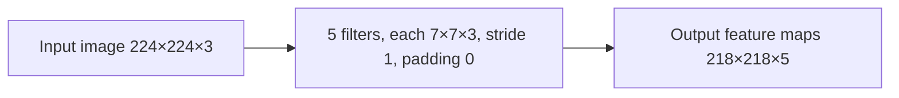

**In simple words:** the height and width shrink because the 7×7 filter must fit inside the image, and the depth becomes 5 because every filter makes one feature map. The parameters count the weights of 5 filters that each cover all 3 colour channels. <Cite id="class-dl-qb2" loc="Q4" />

**Formulas** <Cite id="class-dl-chp4" loc="slide 60" /> <Cite id="class-dl-chp4" loc="slide 66" />

- Output size: $\lfloor (N - F + 2P)/S \rfloor + 1$; output depth $= K$.
- Parameters with bias: $(F \times F \times D + 1) \times K$. Stride and padding are not used.

<Sum>

<Given>

input 224×224×3, $K = 5$ filters of 7×7, stride 1, padding 0.

</Given>

<Find>

(a) the output volume, (b) the trainable parameters with bias, (c) the diagram, (d) the interpretation.

</Find>

<Steps>

1. **(a) Height and width:** $(224 - 7 + 0)/1 + 1 = 217 + 1 = 218$. Depth = number of filters = 5. So **218×218×5**.
2. **(b) Weights per filter:** each filter is 7×7×3, so $7 \cdot 7 \cdot 3 = 147$; add 1 bias: $148$.
3. **All 5 filters:** $148 \times 5 = 740$.

</Steps>

<Answer>

(a) 218×218×5; (b) 740 trainable parameters.

</Answer>

<Box kind="verify">

Positions check: a 7×7 window fits in $224 - 7 + 1 = 218$ places along each side. Parameters in one line: $(7 \cdot 7 \cdot 3 + 1) \times 5 = 148 \times 5 = 740$, and $740 = 5 \times 147 + 5$ (weights plus biases).

</Box>

</Sum>

**(c) Diagram**

**(d) Interpretation.** The spatial size falls from 224 to 218 because there is no padding: the 7×7 filter must lie completely inside the image, so it loses 3 pixels on every side ($224 - 7 + 1 = 218$). The depth is 5, not 3, because each of the 5 filters looks at all 3 colour channels, adds the three results and gives **one** feature map, so 5 filters make 5 maps. The input's 3 channels do not remain in the output. The 740 parameters do not depend on the image size, thanks to weight sharing. <Cite id="class-dl-chp4" loc="slide 26" /> <Cite id="class-dl-chp4" loc="slide 60" />

**Conclusion:** the layer outputs 218×218×5 using 740 trainable parameters.
