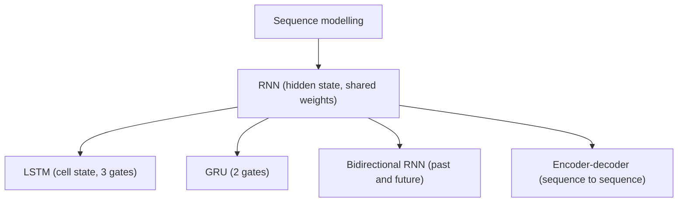

**In simple words:** sequence modelling matlab aise data ke liye model banana jisme items ka order matter karta hai (words, sounds, time ke saath readings). Iske liye RNN, LSTM aur GRU main networks hain. <Cite id="class-dl-qb2" loc="Q5" />

**Definition:** **sequence** wo data hai jisme elements ka order matter karta hai. **Sequence models** wo machine learning models hain jo data ki sequences input ya output karte hain. Sequential data mein text streams, audio clips, video clips aur time-series data aate hain. <Cite id="class-dl-chp5" loc="slide 3" /> <Cite id="class-dl-m5" loc="p. 3" />

**Ye kaunsi problem solve karta hai:** "How can a neural network learn from data when the order and previous information matter?" Feedforward network ke paas pichhle inputs ki memory nahi hoti, isliye hamein aisa network chahiye jo pehle ke steps ki information baad ke steps tak le jaaye. <Cite id="class-dl-chp5" loc="slide 5" />

**Applications:** speech recognition (audio input, text output), sentiment classification (words ki sequence input), video activity recognition (frames ki sequence input), machine translation, music generation, time-series prediction. <Cite id="class-dl-m5" loc="p. 4" /> <Cite id="class-dl-m5" loc="p. 5" /> <Cite id="class-dl-m5" loc="p. 15" />

**Sequence modelling ke liye networks**

1. **RNN:** hidden states wala network jo pichhle outputs ko inputs ki tarah use karne deta hai; har step par same weights. <Cite id="class-dl-m5" loc="p. 9" />
2. **LSTM aur GRU:** gated RNNs jo long-term dependencies aur vanishing gradient problem handle karte hain.
3. **Bidirectional RNN:** sequence ko dono directions mein padhta hai taaki past aur future context use ho. <Cite id="class-dl-m5" loc="p. 32" />
4. **Encoder-decoder (seq2seq):** input sequence ko alag length ki output sequence se map karta hai (translation, captioning). <Cite id="class-dl-m5" loc="p. 38" />
5. **Recursive networks:** RNNs ka tree-structured data tak generalization. <Cite id="class-dl-m5" loc="p. 34" />

**Conclusion:** sequence modelling ko pehle ke items ki memory chahiye; RNNs aur unke gated aur bidirectional versions wo dete hain.
