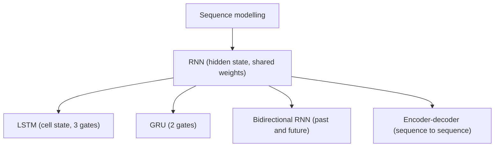

**In simple words:** sequence modelling means building a model for data where the order of the items matters (words, sounds, readings over time). RNN, LSTM and GRU are the main networks used for it. <Cite id="class-dl-qb2" loc="Q5" />

**Definition:** a **sequence** is data where the order of the elements matters. **Sequence models** are machine learning models that input or output sequences of data. Sequential data includes text streams, audio clips, video clips and time-series data. <Cite id="class-dl-chp5" loc="slide 3" /> <Cite id="class-dl-m5" loc="p. 3" />

**The problem it solves:** "How can a neural network learn from data when the order and previous information matter?" A feedforward network has no memory of previous inputs, so we need a network that carries information from earlier steps to later steps. <Cite id="class-dl-chp5" loc="slide 5" />

**Applications:** speech recognition (audio in, text out), sentiment classification (sequence of words in), video activity recognition (sequence of frames in), machine translation, music generation, time-series prediction. <Cite id="class-dl-m5" loc="p. 4" /> <Cite id="class-dl-m5" loc="p. 5" /> <Cite id="class-dl-m5" loc="p. 15" />

**Networks used for sequence modelling**

1. **RNN:** a network with hidden states that lets past outputs be used as inputs; same weights at every step. <Cite id="class-dl-m5" loc="p. 9" />
2. **LSTM and GRU:** gated RNNs that handle long-term dependencies and the vanishing gradient problem.
3. **Bidirectional RNN:** reads the sequence in both directions to use past and future context. <Cite id="class-dl-m5" loc="p. 32" />
4. **Encoder-decoder (seq2seq):** maps an input sequence to an output sequence of a different length (translation, captioning). <Cite id="class-dl-m5" loc="p. 38" />
5. **Recursive networks:** a generalization of RNNs to tree-structured data. <Cite id="class-dl-m5" loc="p. 34" />

**Conclusion:** sequence modelling needs memory of earlier items; RNNs and their gated and bidirectional versions provide it.
