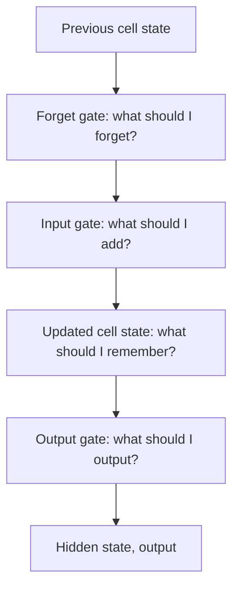

**In simple words:** LSTM ko analyse karna matlab uske parts dekhna: long-term memory (cell state), short-term memory (hidden state) aur teen gates jo tay karte hain ki kya forget, add aur output karna hai. <Cite id="class-dl-qb2" loc="Q5" />

**Definition:** LSTM ek special kind ka recurrent neural network hai jo long-term dependencies handle kar sakta hai; ye RNN ki vanishing gradient problem handle kar sakta hai. LSTM saari information aage le jaane ki jagah gates se memory control karta hai. <Cite id="class-dl-m5" loc="p. 18" /> <Cite id="class-dl-chp5" loc="slide 16" />

**Cell ke parts** <Cite id="class-dl-m5" loc="p. 21" />

- **Cell state** $C_t$: long-term memory, saare time steps mein information carry karta hai.
- **Hidden state** $H_t$: short-term memory, current output ke liye.
- **Forget gate** (selective forget) $f_t = \sigma(x_t U_f + H_{t-1} W_f)$: 0 forget karta hai, 1 rakhta hai.
- **Input gate** (selective write) $i_t = \sigma(x_t U_i + H_{t-1} W_i)$ aur new information $N_t = \tanh(x_t U_c + H_{t-1} W_c)$ jo −1 aur 1 ke beech hoti hai.
- **Output gate** (selective read) $o_t = \sigma(x_t U_o + H_{t-1} W_o)$.

$C_t = f_t C_{t-1} + i_t N_t$ aur $H_t = o_t \tanh(C_t)$. $H_t$ par softmax output deta hai. <Cite id="class-dl-m5" loc="p. 24" /> <Cite id="class-dl-chp5" loc="slide 2" />

**Example:** forget gate 0.2 × old memory 10 = 2; input gate 0.8 × new information 5 = 4; new cell state $2 + 4 = 6$. <Cite id="class-dl-chp5" loc="slide 17" />

**Analysis:** cell state sirf thoda forget karke aur thoda add karke badalta hai, isliye useful information aur gradients kai steps tak travel karte hain; LSTM BPTT se train hota hai. Keemat: zyada complex, zyada parameters. <Cite id="class-dl-chp5" loc="slide 18" />

**Conclusion:** gates memory control karte hain, isliye LSTM long-term dependency problem solve karta hai.
