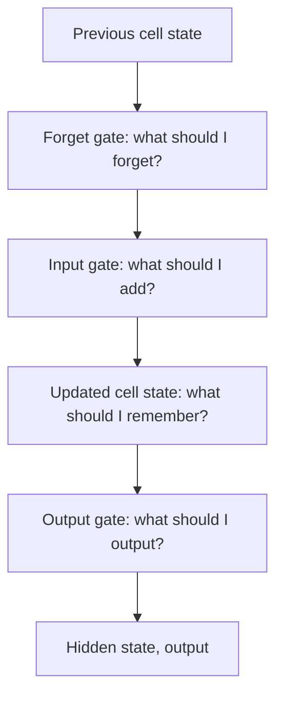

**In simple words:** to analyse the LSTM is to look at its parts: a long-term memory (cell state), a short-term memory (hidden state) and three gates that decide what to forget, add and output. <Cite id="class-dl-qb2" loc="Q5" />

**Definition:** LSTM is a special kind of recurrent neural network capable of handling long-term dependencies; it can handle the vanishing gradient problem faced by the RNN. LSTM controls memory using gates instead of simply carrying all information forward. <Cite id="class-dl-m5" loc="p. 18" /> <Cite id="class-dl-chp5" loc="slide 16" />

**Parts of the cell** <Cite id="class-dl-m5" loc="p. 21" />

- **Cell state** $C_t$: long-term memory, carries information along all time steps.
- **Hidden state** $H_t$: short-term memory, used for the current output.
- **Forget gate** (selective forget) $f_t = \sigma(x_t U_f + H_{t-1} W_f)$: 0 forgets, 1 keeps.
- **Input gate** (selective write) $i_t = \sigma(x_t U_i + H_{t-1} W_i)$ with new information $N_t = \tanh(x_t U_c + H_{t-1} W_c)$ between −1 and 1.
- **Output gate** (selective read) $o_t = \sigma(x_t U_o + H_{t-1} W_o)$.

$C_t = f_t C_{t-1} + i_t N_t$ and $H_t = o_t \tanh(C_t)$. Softmax on $H_t$ gives the output. <Cite id="class-dl-m5" loc="p. 24" /> <Cite id="class-dl-chp5" loc="slide 2" />

**Example:** forget gate 0.2 × old memory 10 = 2; input gate 0.8 × new information 5 = 4; new cell state $2 + 4 = 6$. <Cite id="class-dl-chp5" loc="slide 17" />

**Analysis:** the cell state changes only by forgetting a little and adding a little, so useful information and gradients travel across many steps; LSTM is trained with BPTT. The price: more complex, more parameters. <Cite id="class-dl-chp5" loc="slide 18" />

**Conclusion:** gates control the memory, which is why LSTM solves the long-term dependency problem.
