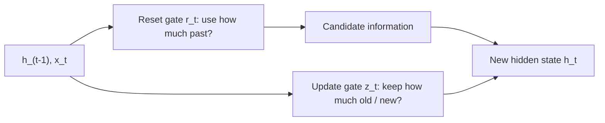

**In simple words:** GRU mein do gates hain. Reset gate tay karta hai ki past ka kitna use karna hai, aur update gate tay karta hai ki purani memory ka kitna rakhna hai aur nayi information kitni leni hai. <Cite id="class-dl-qb2" loc="Q5" />

**Background:** GRU RNN ka ek aur type hai jo information control karne aur long-term dependencies handle karne ke liye gates use karta hai. Isme **alag cell state nahi** hota; hidden state information carry karta hai. LSTM ke teen gates ki jagah do hain, aur dono sigmoid use karte hain, isliye values 0 aur 1 ke beech. <Cite id="class-dl-chp5" loc="slide 20" /> <Cite id="class-dl-m5" loc="p. 28" />

**Reset gate ($r_t$)**

- Intuitively ye control karta hai ki naya input process karte waqt **pichhle state ka kitna hissa hum abhi bhi yaad rakhna chahenge**.
- 0 matlab zyadatar previous information ignore; 1 matlab zyadatar use.
- Isse candidate information banti hai $\tilde{h}_t = \tanh(W_h[x_t, r_t \odot h_{t-1}] + b_h)$.
- Reset gates sequences ki **short-term dependencies** pakadne mein madad karte hain. <Cite id="class-dl-m5" loc="p. 28" /> <Cite id="class-dl-m5" loc="p. 30" />

**Update gate ($z_t$)**

- Ye control karta hai ki **naye state ka kitna hissa bas purane state ki copy hai**: tay karta hai ki kitni information previous hidden state se aayegi aur kitni nayi candidate se.
- $h_t = z_t \odot h_{t-1} + (1 - z_t) \odot \tilde{h}_t$.
- Update gates **long-term dependencies** pakadne mein madad karte hain. <Cite id="class-dl-m5" loc="p. 30" />

**Example:** $h_{t-1} = 10$, candidate $= 4$, $z = 0.7$: $h_t = 0.7 \times 10 + 0.3 \times 4 = 7 + 1.2 = 8.2$. <Cite id="class-dl-chp5" loc="slide 21" />

**Conclusion:** reset gate = past ka kitna use (short-term); update gate = kitna rakhna aur kitna update karna (long-term).
