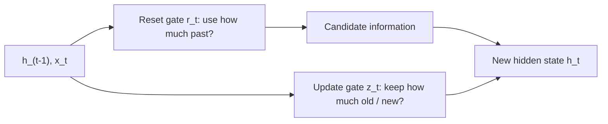

**In simple words:** a GRU has two gates. The reset gate decides how much of the past to use, and the update gate decides how much of the old memory to keep and how much new information to take. <Cite id="class-dl-qb2" loc="Q5" />

**Background:** GRU is another type of RNN that uses gates to control information and handle long-term dependencies. It has **no separate cell state**; the hidden state carries the information. The LSTM's three gates are replaced by two, and both use sigmoid, so their values lie between 0 and 1. <Cite id="class-dl-chp5" loc="slide 20" /> <Cite id="class-dl-m5" loc="p. 28" />

**Reset gate ($r_t$)**

- Intuitively it controls **how much of the previous state we might still want to remember** when processing the new input.
- 0 means ignore most previous information; 1 means use most of it.
- It is used to build the candidate information $\tilde{h}_t = \tanh(W_h[x_t, r_t \odot h_{t-1}] + b_h)$.
- Reset gates help capture **short-term dependencies** in sequences. <Cite id="class-dl-m5" loc="p. 28" /> <Cite id="class-dl-m5" loc="p. 30" />

**Update gate ($z_t$)**

- It controls **how much of the new state is just a copy of the old state**: it decides how much information comes from the previous hidden state and how much from the new candidate.
- $h_t = z_t \odot h_{t-1} + (1 - z_t) \odot \tilde{h}_t$.
- Update gates help capture **long-term dependencies** in sequences. <Cite id="class-dl-m5" loc="p. 30" />

**Example:** $h_{t-1} = 10$, candidate $= 4$, $z = 0.7$: $h_t = 0.7 \times 10 + 0.3 \times 4 = 7 + 1.2 = 8.2$. <Cite id="class-dl-chp5" loc="slide 21" />

**Conclusion:** reset gate = how much past to use (short-term); update gate = how much to keep and how much to update (long-term).
