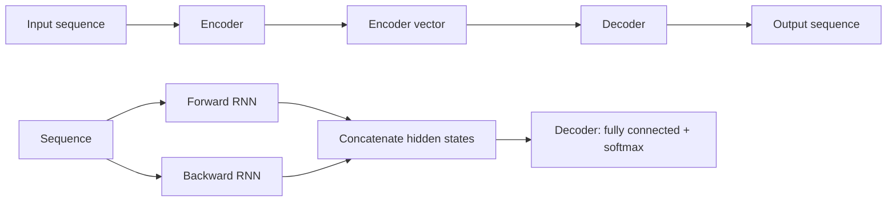

**In simple words:** encoder-decoder RNN poori input sequence ko ek summary vector mein padhta hai aur phir usse output sequence likhta hai. Bidirectional RNN wahi sequence forward aur backward dono padhta hai taaki har position past aur future dono dekhe. <Cite id="class-dl-qb2" loc="Q5" />

**Encoder-decoder (sequence to sequence).** Sequence to sequence model input sequence ko output sequence se map karta hai jahan lengths alag ho sakti hain, jaise "What are you doing today?" (5 words) ka 7 symbols ka Chinese sentence. Uses: machine translation, speech recognition, image captioning. <Cite id="class-dl-m5" loc="p. 38" />

1. **Encoder:** recurrent units ka stack (behtar performance ke liye LSTM ya GRU cells); har ek input ka ek element leta hai aur information aage bhejta hai. $h_t = f(W^{(hh)} h_{t-1} + W^{(hx)} x_t)$. <Cite id="class-dl-m5" loc="p. 40" />
2. **Encoder vector:** final hidden state; ye saare input elements ki information rakhta hai aur **decoder ka initial hidden state** hai. <Cite id="class-dl-m5" loc="p. 41" />
3. **Decoder:** recurrent units ka stack, har ek output $y_t$ predict karta hai; $h_t = f(W^{(hh)} h_{t-1})$, $y_t = \text{softmax}(W^S h_t)$. <Cite id="class-dl-m5" loc="p. 42" />

**Bidirectional RNN.** Hum do alag sequences dekhte hain, ek left se right aur doosri ulti order mein; "I love mango juice" ke liye backward layer "juice mango love I" padhti hai. Typically do RNNs use hote hain, unke hidden states concatenate hote hain, aur final hidden state decoder (jaise fully connected network softmax ke saath) mein jaati hai. **Limitations:** poori sequence available honi chahiye (real-time speech ke liye suitable nahi), agla word predict karne ke liye suitable nahi, aur RNN se slow. <Cite id="class-dl-m5" loc="p. 32" /> <Cite id="class-dl-m5" loc="p. 33" />

**Conclusion:** encoder-decoder alag lengths ki sequences map karta hai; bidirectional RNN context ki dono directions use karta hai.
