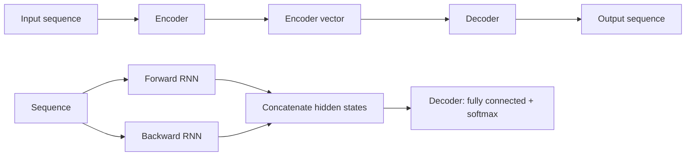

**In simple words:** an encoder-decoder RNN reads a whole input sequence into one summary vector and then writes an output sequence from it. A bidirectional RNN reads the same sequence both forward and backward so each position sees past and future. <Cite id="class-dl-qb2" loc="Q5" />

**Encoder-decoder (sequence to sequence).** A sequence to sequence model maps an input sequence to an output sequence where the lengths may differ, for example "What are you doing today?" (5 words) to a Chinese sentence of 7 symbols. Uses: machine translation, speech recognition, image captioning. <Cite id="class-dl-m5" loc="p. 38" />

1. **Encoder:** a stack of recurrent units (LSTM or GRU cells for better performance); each takes one input element and passes information forward. $h_t = f(W^{(hh)} h_{t-1} + W^{(hx)} x_t)$. <Cite id="class-dl-m5" loc="p. 40" />
2. **Encoder vector:** the final hidden state; it holds the information of all input elements and is the **initial hidden state of the decoder**. <Cite id="class-dl-m5" loc="p. 41" />
3. **Decoder:** a stack of recurrent units, each predicting an output $y_t$; $h_t = f(W^{(hh)} h_{t-1})$, $y_t = \text{softmax}(W^S h_t)$. <Cite id="class-dl-m5" loc="p. 42" />

**Bidirectional RNN.** We consider two separate sequences, one left to right and the other in the reverse order; for "I love mango juice" the backward layer reads "juice mango love I". Typically two RNNs are used, their hidden states are concatenated, and the final hidden state goes to a decoder such as a fully connected network with softmax. **Limitations:** the whole sequence must be available (not suited to real-time speech), not suitable for predicting the next word, and slower than an RNN. <Cite id="class-dl-m5" loc="p. 32" /> <Cite id="class-dl-m5" loc="p. 33" />

**Conclusion:** encoder-decoder maps sequences of different lengths; bidirectional RNN uses both directions of context.
