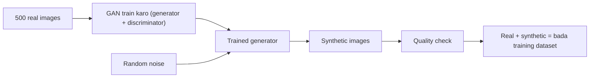

**In simple words:** jab hamare paas real data thoda ho, to hum us par GAN train kar sakte hain aur phir trained generator se bahut saare naye, milte-julte samples bana sakte hain. Unhe real data mein jodne se machine-learning model ke liye bada aur zyada diverse training set milta hai. <Cite id="class-dl-chp6" loc="slide 22" />

**Kyun:** real data aksar limited hota hai, ya use collect karna mushkil hota hai. GANs additional training samples generate kar sakte hain, jisse model performance behtar hoti hai aur bade real data par dependency kam hoti hai. <Cite id="class-dl-chp6" loc="slide 22" />

**Steps (500 real images ke example ke saath):**

1. **Limited real data:** maano hamare paas sirf 500 real images hain aur training dataset behtar karne ke liye aur examples chahiye.
2. **GAN train karo** 500 real images par; result trained generator hai.
3. **Synthetic samples generate karo:** generator random noise se naye samples banata hai.
4. **Discriminator check karta hai** ki generated samples real training data jaise lagte hain ya nahi.
5. **Feedback aur improvement:** loss, backpropagation aur generator ka update kai baar repeat hota hai.
6. **Final result:** synthetic images ko real images mein jod dete hain, jisse bada training dataset milta hai. <Cite id="class-dl-chp6" loc="slide 22" />

**Important:** synthetic images ko training data ki tarah use karne se pehle quality-check karna chahiye, kyunki saare generated samples achhe nahi hote; kuch unnatural dikhte hain ya artifacts rakhte hain. Goal useful aur diverse samples jodna hai, sirf zyada data nahi. <Cite id="class-dl-chp6" loc="slide 22" />

**Use cases:** image classification ke liye zyada data, chhote datasets ke liye data augmentation, model generalization behtar karna, aur research aur testing ke liye diverse samples banana. Medical imaging mein synthetic images research aur augmentation ke liye hain, direct diagnosis ke liye nahi. <Cite id="class-dl-chp6" loc="slide 25" />

**Conclusion:** GAN se bana synthetic data zyada training samples deta hai, model performance behtar karta hai aur bade real data par dependence kam karta hai. <Cite id="class-dl-chp6" loc="slide 22" />
