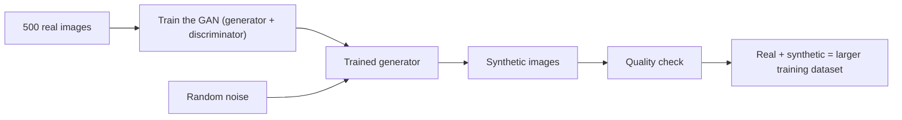

**In simple words:** when we have only a little real data, we can train a GAN on it and then use the trained generator to create many new, similar samples. Adding them to the real data gives a larger and more diverse training set for the machine-learning model. <Cite id="class-dl-chp6" loc="slide 22" />

**Why:** real data is often limited, or collecting it is difficult. GANs can generate additional training samples, which improves model performance and reduces the dependency on large amounts of real data. <Cite id="class-dl-chp6" loc="slide 22" />

**Steps (example with 500 real images):**

1. **Limited real data:** suppose we have only 500 real images and want more examples to improve the training dataset.
2. **Train the GAN** using the 500 real images; the result is a trained generator.
3. **Generate synthetic samples:** the generator creates new samples from random noise.
4. **Discriminator checks** whether the generated samples resemble the real training data.
5. **Feedback and improvement:** the loss, backpropagation and update of the generator repeat many times.
6. **Final result:** the synthetic images are added to the real ones, giving a larger training dataset. <Cite id="class-dl-chp6" loc="slide 22" />

**Important:** synthetic images should be quality-checked before use as training data, because not all generated samples are good; some look unnatural or contain artifacts. The goal is to add useful and diverse samples, not just more data. <Cite id="class-dl-chp6" loc="slide 22" />

**Use cases:** more data for image classification, data augmentation for small datasets, improving model generalization, and creating diverse samples for research and testing. In medical imaging synthetic images are for research and augmentation, not direct diagnosis. <Cite id="class-dl-chp6" loc="slide 25" />

**Conclusion:** GAN-generated synthetic data creates more training samples, improves model performance and reduces dependence on large amounts of real data. <Cite id="class-dl-chp6" loc="slide 22" />
