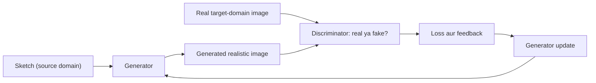

**In simple words:** image-to-image translation GAN se ek domain ki image ko dusre domain mein badalta hai, jaise sketch ko realistic image mein. Generator badli hui image banata hai aur discriminator check karta hai ki wo target domain ki real image jaisi dikhti hai ya nahi. <Cite id="class-dl-chp6" loc="slide 19" />

**Idea:** GAN adversarial training process se source domain (jaise sketch) se target domain (jaise realistic image) ka mapping seekhta hai. Dusre examples: day se night, summer se winter. <Cite id="class-dl-chp6" loc="slide 16" /> <Cite id="class-dl-chp6" loc="slide 19" />

**Steps** <Cite id="class-dl-chp6" loc="slide 19" />

1. **Generator ko sketch do:** use source domain ki image milti hai.
2. **Generator realistic image banata hai:** wo sketch ko target domain ki realistic-looking image mein badalta hai.
3. **Discriminator image check karta hai:** use real target-domain image aur generated image milti hain aur wo poochta hai "does this generated image look like a real image from the target domain?"
4. **Loss nikalo aur feedback do:** generated image realistic na ho to discriminator ki prediction galat hoti hai, loss badhta hai aur generator ko feedback milta hai. Image realistic ho to loss low.
5. **Generator phir koshish karta hai:** feedback se wo apne parameters update karta hai aur behtar image banata hai.
6. **Repeat** kai iterations tak, jab tak generator realistic images na banaye aur discriminator ko difference batana aasan na rahe.

**Conclusion:** image-to-image translation GAN se source domain (sketch) se target domain (realistic image) ka mapping adversarial training ke through seekhta hai. <Cite id="class-dl-chp6" loc="slide 19" />
