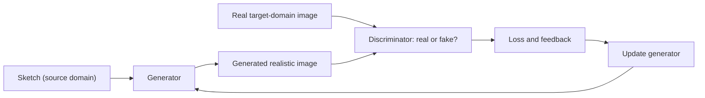

**In simple words:** image-to-image translation uses a GAN to convert an image from one domain into another, for example a sketch into a realistic image. The generator makes the converted image and the discriminator checks whether it looks like a real image of the target domain. <Cite id="class-dl-chp6" loc="slide 19" />

**Idea:** the GAN learns the mapping from a source domain (for example a sketch) to a target domain (for example a realistic image) through an adversarial training process. Other examples: day to night, summer to winter. <Cite id="class-dl-chp6" loc="slide 16" /> <Cite id="class-dl-chp6" loc="slide 19" />

**Steps** <Cite id="class-dl-chp6" loc="slide 19" />

1. **Give the generator a sketch:** it receives an image from the source domain.
2. **The generator produces a realistic image:** it transforms the sketch into a realistic-looking image in the target domain.
3. **The discriminator checks the image:** it receives the real target-domain image and the generated image and asks "does this generated image look like a real image from the target domain?"
4. **Calculate loss and give feedback:** if the generated image does not look realistic, the discriminator's prediction is incorrect, the loss increases and gives feedback to the generator. If the image is realistic the loss is low.
5. **The generator tries again:** using the feedback it updates its parameters and creates a better image.
6. **Repeat** for many iterations until the generator produces realistic images and the discriminator can no longer easily tell the difference.

**Conclusion:** image-to-image translation uses a GAN to learn the mapping from a source domain (a sketch) to a target domain (a realistic image) through adversarial training. <Cite id="class-dl-chp6" loc="slide 19" />
