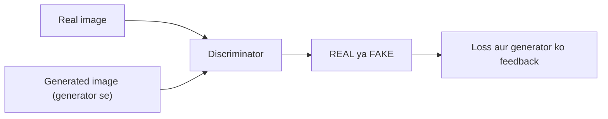

**In simple words:** discriminator GAN ka judge hai. Wo ek image dekhta hai aur kehta hai ki wo real hai ya generated, aur uska jawab generator ko improve hone ke liye zaroori feedback deta hai. <Cite id="class-dl-chp6" loc="slide 9" />

**Discriminator ka role** <Cite id="class-dl-chp6" loc="slide 9" />

- **Zimmedari:** check karna ki input real hai ya generated.
- **Input:** dataset ki real image aur generator ki generated image.
- **Output:** REAL ya FAKE.
- **Goal:** real images ko generated images se sahi alag pehchaanna. Ise art critic ki tarah socho jo check karta hai ki painting genuine hai ya fake.

**Kyun important hai:** iski prediction loss banati hai; ye galti kare to iska apna loss badhta hai, aur backpropagation dono networks ko update karti hai. Generator is feedback se apni images ko zyada realistic banata hai, jabki discriminator khud fakes detect karne mein behtar hota hai. <Cite id="class-dl-chp6" loc="slide 10" />

Discriminator mainly training ke dauran chahiye; training ke baad akela trained generator naye samples banata hai. <Cite id="class-dl-chp6" loc="slide 11" />

**Conclusion:** discriminator real vs fake check karta hai aur generator ko behtar samples banane ke liye dhakelta hai.
