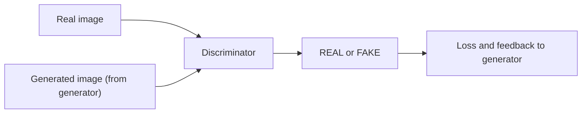

**In simple words:** the discriminator is the judge of a GAN. It looks at an image and says whether it is real or generated, and its answer gives the generator the feedback it needs to improve. <Cite id="class-dl-chp6" loc="slide 9" />

**Role of the discriminator** <Cite id="class-dl-chp6" loc="slide 9" />

- **Responsible for** checking whether an input is real or generated.
- **Input:** a real image from the dataset and a generated image from the generator.
- **Output:** REAL or FAKE.
- **Goal:** correctly distinguish real images from generated images. Think of it as an art critic checking whether a painting is genuine or fake.

**Why it matters:** its prediction produces the loss; if it makes mistakes its own loss increases, and backpropagation updates both networks. The generator uses this feedback to make its images more realistic, while the discriminator itself becomes better at detecting fakes. <Cite id="class-dl-chp6" loc="slide 10" />

The discriminator is mainly needed during training; after training the trained generator alone creates new samples. <Cite id="class-dl-chp6" loc="slide 11" />

**Conclusion:** the discriminator checks real versus fake and pushes the generator to produce better samples.
