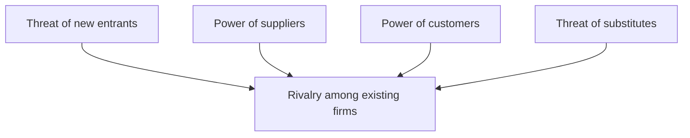

**Ek line mein:** <mark>Competitive environment firms ko innovate karne aur cost ghatane pe majboor karta hai, customers ko fayda hota hai, lekin profit dabta hai aur kharcha badhta hai</mark>. <Cite id="it-impact-society-wiki-competitive-advantage" />

<Box kind="key">

**Ye points likho:**

- <mark>Competitive environment = kai rivals ek hi customers ke liye price, quality ya service se ladte hain</mark>.
- <mark>Porter's five forces: new entrants, supplier power, customer power, substitutes, rivalry</mark>.
- <mark>Advantages: innovation, efficiency, customers ko better quality aur kam price, benchmarking</mark>.
- <mark>Disadvantages: price wars, zyada kharcha, kamzor firms fail, quality mein shortcut ka lalach</mark>.
- IS se link: jo system koi bhi rival kharid sakta hai wo sirf **chhota** edge deta hai.
- Dono sides ki **table** banao; "contrast" matlab side by side.

</Box>

## Core answer (5 marks, yahan ke har question ke liye)

<Box kind="definition">

A **competitive environment** is a market, or workplace, where several rivals try to win the same customers or rewards by offering better price, quality or service. <Cite id="it-impact-society-wiki-competitive-advantage" />

</Box>

**Kitna tough hai?** Porter's five forces samjhate hain. Forces jitni strong, profit kamana utna mushkil. <Cite id="it-impact-society-porter-hbr2008" /> <Cite id="it-impact-society-hbs-five-forces" />

| Advantages | Disadvantages |
|---|---|
| Firm ko innovate karne pe push | Price wars se profit margin kam |
| Efficiency aur kam cost | Marketing, technology, research pe zyada kharcha |
| Customers ko better quality, kam price, zyada choice | Kamzor firms fail, jobs jaati hain |
| Rivals se seekhna (benchmarking) | Quality ya ethics mein shortcut ka lalach |

**Conclusion:** <mark>competition customers ko fayda deta hai aur innovation badhata hai, lekin firms ka profit aur mehnat leta hai</mark>, isliye firm ko IS aur apni strengths se aage rehna padta hai.

## Extended answer (10 marks): ye add karo

### 1. Dono sides ke aur points

| Advantages | Disadvantages |
|---|---|
| Employees motivated, skills improve | Zyada internal rivalry se stress aur kam sharing |
| IS ka strategic use badhta hai | IS advantage jaldi copy ho jaata hai, edge chhota |
| Advertising aur improvement se market badhta hai | Discount aur advertising ka cost sabke liye badhta hai |

### 2. Example

Amazon aur Flipkart delivery speed aur price pe compete karte hain. Customers ko fast delivery aur offers milte hain, lekin dono firms discounts pe bahut kharch karti hain, jisse profit ghatta hai. <Cite id="it-impact-society-tp-five-forces" />

### 3. Information systems se link

Jo system koi bhi rival kharid sakta hai wo sirf chhota advantage deta hai. **Lasting** edge tab aata hai jab IS ko firm ke apne processes, data aur logon ke saath joda jaye. <Cite id="it-impact-society-wiki-five-forces" />

## Har question mein kaise fit karein

- **"Contrast to bring out the advantages and disadvantages of Competitive environment in an organization."** (10 marks) <PYQ id="2024-05-ce/q3a" />: definition, five-forces diagram, side-by-side table (core aur section 1), example, IS se link, conclusion.

## Exam tips

- **Five-forces diagram draw karo** aur paancho naam likho.
- "Contrast" matlab **ek table, do columns**; do lambe paragraphs nahi.
- Ek real rivalry example do (Amazon vs Flipkart, Jio vs Airtel).

Exam mein English mein likho.
