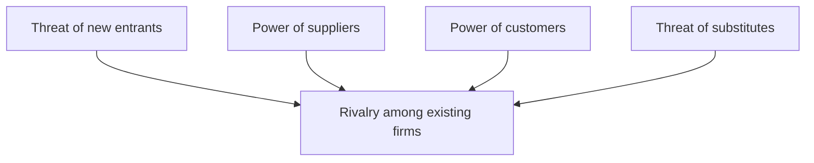

**In one line:** <mark>A competitive environment makes firms innovate and cut costs, and customers gain, but it squeezes profit and raises spending</mark>. <Cite id="it-impact-society-wiki-competitive-advantage" />

<Box kind="key">

**Key points to write:**

- <mark>Competitive environment = many rivals fight for the same customers by price, quality or service</mark>.
- <mark>Porter's five forces: new entrants, supplier power, customer power, substitutes, rivalry</mark>.
- <mark>Advantages: innovation, efficiency, better quality and lower prices for customers, benchmarking</mark>.
- <mark>Disadvantages: price wars, high spending, weak firms fail, temptation to cut corners</mark>.
- Link to IS: a system any rival can buy gives only a **short** edge.
- Use a **table** with both sides; "contrast" means side by side.

</Box>

## Core answer (5 marks, fits every question here)

<Box kind="definition">

A **competitive environment** is a market, or workplace, where several rivals try to win the same customers or rewards by offering better price, quality or service. <Cite id="it-impact-society-wiki-competitive-advantage" />

</Box>

**How tough is it?** Porter's five forces explain it. The stronger the forces, the harder it is to earn profit. <Cite id="it-impact-society-porter-hbr2008" /> <Cite id="it-impact-society-hbs-five-forces" />

| Advantages | Disadvantages |
|---|---|
| Pushes the firm to innovate | Price wars cut profit margins |
| Forces efficiency and lower costs | High spending on marketing, technology, research |
| Customers get better quality, lower prices, more choice | Weak firms fail and jobs are lost |
| Firm learns from rivals (benchmarking) | Temptation to cut corners on quality or ethics |

**Conclusion:** <mark>competition benefits customers and drives innovation, but costs firms profit and effort</mark>, so a firm must use IS and its own strengths to stay ahead.

## Extended answer (10 marks): add these

### 1. More points on each side

| Advantages | Disadvantages |
|---|---|
| Employees stay motivated and skills improve | Too much internal rivalry causes stress and less sharing |
| Encourages strategic use of IS to stay ahead | IS advantages are copied quickly, so the edge is short |
| Market grows as firms advertise and improve | Costs of discounts and advertising rise for everyone |

### 2. Example

Amazon and Flipkart compete on delivery speed and price. Customers gain from faster delivery and offers, but both firms spend heavily on discounts, which reduces profit. <Cite id="it-impact-society-tp-five-forces" />

### 3. Link to information systems

A system that any rival can buy gives only a short advantage. A **lasting** edge comes from combining IS with the firm's own processes, data and people. <Cite id="it-impact-society-wiki-five-forces" />

## Fit it to each question

- **"Contrast to bring out the advantages and disadvantages of Competitive environment in an organization."** (10 marks) <PYQ id="2024-05-ce/q3a" />: definition, five-forces diagram, side-by-side table (sections core and 1), example, link to IS, conclusion.

## Exam tips

- **Draw** the five-forces diagram and name all five.
- "Contrast" means **one table, two columns**; do not write two long paragraphs.
- Give one real rivalry example (Amazon versus Flipkart, Jio versus Airtel).
