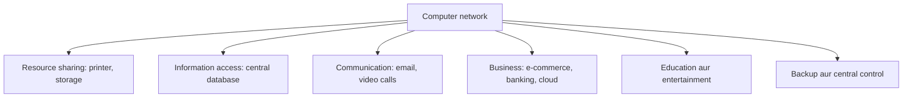

**Ek line mein:** <mark>Computer network cables ya wireless links se jude computers aur devices ka set hai jo data exchange aur resources share karte hain</mark>, aur iske applications hain resource sharing, information access, communication, e-commerce, cloud aur remote work, banking, education aur entertainment, aur backup aur control. <Cite id="networks-wireless-rainer-iis" /> <Cite id="networks-wireless-gfg-importance" />

<Box kind="key">

**Computer networks ke applications mein ye points likho:**

- <mark>Resource sharing</mark>: ek printer, storage ya software kai users ke liye.
- <mark>Information sharing aur access</mark>: ek central database, ek latest copy.
- <mark>Communication</mark>: email, chat, voice aur video calls.
- <mark>E-commerce aur online services</mark>, <mark>banking aur finance</mark> (ATMs, UPI), <mark>cloud aur remote work</mark>.
- <mark>Education aur entertainment</mark>, aur <mark>backup, security aur central control</mark>.
- Har ka **real example** do, aur **disadvantages** pe ek line (cost, ek failure kai ko affect, virus tezi se failta hai).

</Box>

## Core answer (5 marks, yahan ke har question ke liye)

<Box kind="definition">

A **computer network** is a set of computers and other devices connected by cables or wireless links so that they can exchange data and share resources such as files, printers and an Internet connection. <Cite id="networks-wireless-wiki-computer-network" /> <Cite id="networks-wireless-ibm-networking" />

</Box>

**Kyun chahiye:** network ke bina har computer ek island hai, apne printer aur har file ki apni copy ke saath. Network kai logon ko ek resource share, same data pe kaam aur turant baat karne deta hai. Network shehar ke road system jaisa hai: computers ghar, links roads aur data traffic. <Cite id="networks-wireless-gfg-importance" />

**Applications:**

| # | Application | Example |
|---|---|---|
| 1 | Resource sharing: printer, scanner, storage, software licence | College lab ke saare computers ek printer use karte hain |
| 2 | Information sharing aur access: server pe ek latest copy | Bank branch central database se balance padhti hai |
| 3 | Communication: email, chat, voice, video | Pune aur London ka Infosys staff video meeting karta hai |
| 4 | E-commerce aur online services | Amazon, Flipkart, UPI payments |
| 5 | Cloud computing aur remote work | Staff ghar se office systems mein login |
| 6 | Banking aur finance | SBI ka ATM network |
| 7 | Education aur entertainment | NPTEL lectures, Netflix |
| 8 | Backup, security aur control | Data doosri machine pe copy; admin sab users ke rules set karta hai |

<Cite id="networks-wireless-gfg-importance" /> <Cite id="networks-wireless-ibm-networking" /> <Cite id="networks-wireless-gfg-basics" />

**Disadvantages:** set-up aur maintenance cost, ek failure kai users ko ek saath rok sakti hai, aur virus ya hacker ek device se baaki sab tak tezi se phail sakta hai.

**Conclusion:** <mark>networks logon aur firms ko resources aur information share karne dete hain, jisse cost aur time bachta hai</mark>, lekin security aur maintenance chahiye.

## Extended answer (10 marks): ye add karo

### 1. Size ke hisaab se network types

| Point | PAN | LAN | MAN | WAN |
|---|---|---|---|---|
| Full form | Personal Area Network | Local Area Network | Metropolitan Area Network | Wide Area Network |
| Area | Lagbhag 10 m | Building ya campus | Ek shehar | Desh ya duniya |
| Example | Bluetooth earbuds wala phone | College computer lab | Shehar bhar ka bank network | Internet, poore India mein bank |

<Cite id="networks-wireless-gfg-area-types" /> <Cite id="networks-wireless-tp-network-types" />

### 2. Internet, intranet aur extranet

**Internet** public worldwide network hai. **Intranet** firm ke andar private network hai jo Internet technology use karta hai (jaise HR portal). **Extranet** wo intranet hai jo controlled tareeke se suppliers jaise bahar walon ke liye khola jaata hai (Walmart suppliers ko stock levels dikhata hai). <Cite id="networks-wireless-wiki-intranet" /> <Cite id="networks-wireless-wiki-extranet" />

### 3. Business view: firms networks kaise use karti hain

| Firm | Network kaise dikhta hai |
|---|---|
| SBI | Bada WAN branches, ATMs aur data centres ko jodta hai |
| Amazon | Data centres ke beech fibre links, warehouses mein Wi-Fi scanners |
| Zomato, Swiggy | Delivery partners ke phones 4G ya 5G se cloud servers tak |
| Walmart | Extranet suppliers ko stock aur sales dikhata hai |

## Har question mein kaise fit karein

- **"Explain the applications of computer networks."** (5 marks) <PYQ id="2023-12-ce/q1d" />: **core answer** likho: one-line definition, aath applications example ke saath (chhoti table), disadvantages pe ek line. Time ho to diagram jodo.

## Exam tips

- **Aath points** likho aur har ke saath real example; 5 marks ke liye one-line points kaafi hain.
- Indian examples use karo (UPI, ATM, IRCTC, Jio), pehchanna aasan hai.
- **Disadvantages ki line** mat bhoolo; isse balance dikhta hai.

Exam mein English mein likho.
