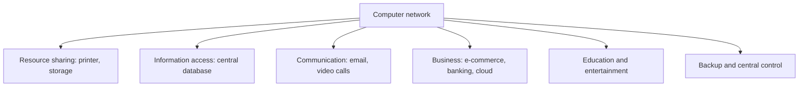

**In one line:** <mark>A computer network is a set of computers and devices connected by cables or wireless links to exchange data and share resources</mark>, and its applications are resource sharing, information access, communication, e-commerce, cloud and remote work, banking, education and entertainment, and backup and control. <Cite id="networks-wireless-rainer-iis" /> <Cite id="networks-wireless-gfg-importance" />

<Box kind="key">

**Key points to write (applications of computer networks):**

- <mark>Resource sharing</mark>: one printer, storage or software for many users.
- <mark>Information sharing and access</mark>: one central database, one latest copy.
- <mark>Communication</mark>: email, chat, voice and video calls.
- <mark>E-commerce and online services</mark>, <mark>banking and finance</mark> (ATMs, UPI), <mark>cloud and remote work</mark>.
- <mark>Education and entertainment</mark>, and <mark>backup, security and central control</mark>.
- Give a **real example** for each, and one line on **disadvantages** (cost, one failure affects many, virus spreads fast).

</Box>

## Core answer (5 marks, fits every question here)

<Box kind="definition">

A **computer network** is a set of computers and other devices connected by cables or wireless links so that they can exchange data and share resources such as files, printers and an Internet connection. <Cite id="networks-wireless-wiki-computer-network" /> <Cite id="networks-wireless-ibm-networking" />

</Box>

**Why it is needed:** without a network every computer is an island, with its own printer and its own copy of every file. A network lets many people share one resource, work on the same data and talk instantly. A network is like the road system of a city: computers are houses, links are roads and data is the traffic. <Cite id="networks-wireless-gfg-importance" />

**Applications:**

| # | Application | Example |
|---|---|---|
| 1 | Resource sharing: printer, scanner, storage, software licence | All computers in a college lab use one printer |
| 2 | Information sharing and access: one latest copy on a server | A bank branch reads a balance from the central database |
| 3 | Communication: email, chat, voice, video | Infosys staff in Pune and London hold a video meeting |
| 4 | E-commerce and online services | Amazon, Flipkart, UPI payments |
| 5 | Cloud computing and remote work | Staff log in to office systems from home |
| 6 | Banking and finance | SBI's ATM network |
| 7 | Education and entertainment | NPTEL lectures, Netflix |
| 8 | Backup, security and control | Data copied to another machine; admin sets rules for all users |

<Cite id="networks-wireless-gfg-importance" /> <Cite id="networks-wireless-ibm-networking" /> <Cite id="networks-wireless-gfg-basics" />

**Disadvantages:** set-up and maintenance cost, a failure can stop many users at once, and a virus or hacker can spread quickly from one device to all others.

**Conclusion:** <mark>networks let people and firms share resources and information, which saves cost and time</mark>, but they need security and maintenance.

## Extended answer (10 marks): add these

### 1. Types of network by size

| Point | PAN | LAN | MAN | WAN |
|---|---|---|---|---|
| Full form | Personal Area Network | Local Area Network | Metropolitan Area Network | Wide Area Network |
| Area | About 10 m | Building or campus | A city | Country or world |
| Example | Phone with Bluetooth earbuds | College computer lab | City-wide bank network | The Internet, a bank across India |

<Cite id="networks-wireless-gfg-area-types" /> <Cite id="networks-wireless-tp-network-types" />

### 2. Internet, intranet and extranet

The **Internet** is the public worldwide network. An **intranet** is a private network inside a firm using Internet technology (for example an HR portal). An **extranet** is an intranet opened in a controlled way to outsiders such as suppliers (Walmart letting suppliers see stock levels). <Cite id="networks-wireless-wiki-intranet" /> <Cite id="networks-wireless-wiki-extranet" />

### 3. Business view: how firms use networks

| Firm | How the network shows up |
|---|---|
| SBI | A huge WAN joins branches, ATMs and data centres |
| Amazon | Fibre links between data centres, Wi-Fi scanners in warehouses |
| Zomato, Swiggy | Delivery partners' phones use 4G or 5G to reach cloud servers |
| Walmart | An extranet lets suppliers see stock and sales |

## Fit it to each question

- **"Explain the applications of computer networks."** (5 marks) <PYQ id="2023-12-ce/q1d" />: write the **core answer**: one-line definition, the eight applications with an example each (short table), one line on disadvantages. Add the diagram if time allows.

## Exam tips

- **Write eight points** and a real example beside each; one-line points are enough for 5 marks.
- Use Indian examples (UPI, ATM, IRCTC, Jio) as they are easy to recognise.
- Do not forget the **disadvantages line**; it shows balance.
