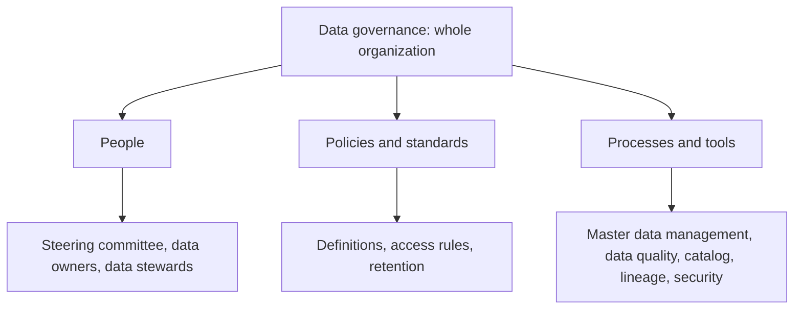
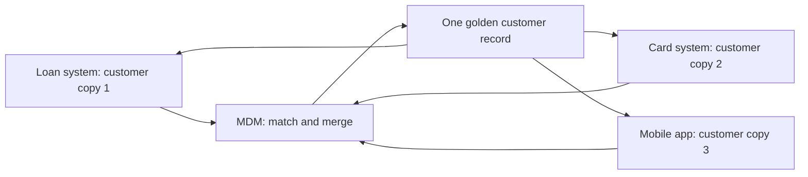

**Ek line mein:** <mark>Poori organization mein information manage karne ka approach data governance hai, jiska main tool master data management (MDM) hai, aur ye teen parts pe bana hai: people, policies aur standards, processes aur tools</mark>. <Cite id="data-management-ibm-data-governance" />

<Box kind="key">

**Ye points likho:**

- <mark>Data governance = poori organization mein information manage karne ka approach</mark>.
- Database sirf data **store** karta hai; governance **owner, meaning, quality aur access** decide karta hai.
- <mark>Teen categories: people, policies aur standards, processes aur tools</mark>.
- <mark>Master data management har customer ya product ka ek "golden record" deta hai</mark>.
- **Benefits:** one version of the truth, better quality, kam risk, legal compliance aasaan (GDPR, India ka DPDP Act).
- Example: bank loan, card aur mobile app systems mein ek hi customer record use karta hai.

</Box>

## Core answer (5 marks, yahan ke har question ke liye)

<Box kind="definition">

**Data governance** is the set of policies, standards, roles and processes that decide how data is created, stored, used, protected and retired across the whole organization. IBM describes it as managing the quality, security and availability of data. <Cite id="data-management-wiki-data-governance" /> <Cite id="data-management-ibm-data-governance" />

</Box>

**Approach kyun chahiye:** database data store karta hai, lekin ye decide nahi karta ki data kiska hai, uska matlab kya hai, kitna achha hona chahiye ya kaun dekh sakta hai.

**Approach ki categories**

1. **People:** steering committee ya chief data officer strategy set karta hai; data owners ek area ke liye accountable; data stewards roz ki dekhbhal.
2. **Policies aur standards:** common definitions ("active customer" kise kahenge), naming aur format rules, access rules, data kitne time rakhna.
3. **Processes aur tools:** master data management, data quality checks, data catalog, lineage tracking aur access security. <Cite id="data-management-ibm-mdm" /> <Cite id="data-management-gfg-mdm" />

**Conclusion:** <mark>data governance, master data management ke saath, poori organization mein information ko asset ki tarah manage karta hai</mark>.

## Extended answer (10 marks): ye add karo

### 1. Master data management (MDM)

MDM har core item (customer, product, supplier) ka **ek trusted record** ("golden record") rakhta hai aur baaki sab systems ko usse check karta hai.

### 2. Benefits

- Departments ke beech **one version of the truth**.
- **Better data quality**, kam errors.
- Leaks aur misuse ka **kam risk**.
- GDPR aur India ke DPDP Act ka **compliance aasaan**.

### 3. Governance ke bina vs saath

| Governance ke bina | Governance ke saath |
|---|---|
| Har department ki apni copy | Ek shared, trusted record |
| Ek hi word ke alag matlab | Common definitions |
| Koi bhi koi bhi data khol sakta hai | Role ke hisaab se access |
| Errors repeat | Owner cause theek karta hai |

## Har question mein kaise fit karein

- **"Categorize the approach to managing information across an entire organization"** (5 marks) <PYQ id="2023-05-ce/q1e" /> <PYQ id="2024-12-ce/q1e" />: approach ka naam (data governance), teen categories diagram ke saath, MDM ek line mein aur bank example.

## Exam tips

- **Pehle approach ka naam likho**: "data governance".
- **Teen categories** numbered list mein likho aur tree draw karo.
- End mein **benefits**: one version of the truth.

Exam mein English mein likho.
