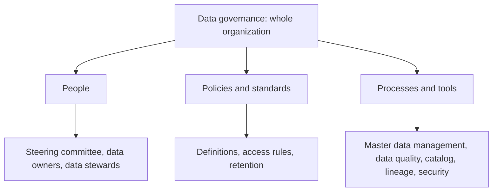
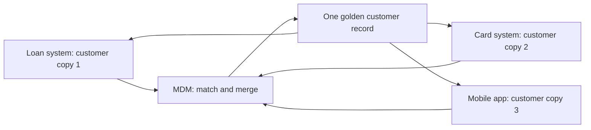

**In one line:** <mark>The approach to managing information across an entire organization is data governance, with master data management (MDM) as its main tool, built on three parts: people, policies and standards, and processes and tools</mark>. <Cite id="data-management-ibm-data-governance" />

<Box kind="key">

**Key points to write:**

- <mark>Data governance = an approach to managing information across the entire organization</mark>.
- A database only **stores** data; governance decides **owner, meaning, quality and access**.
- <mark>Three categories: people, policies and standards, processes and tools</mark>.
- <mark>Master data management gives one "golden record" per customer or product</mark>.
- **Benefits:** one version of the truth, better quality, less risk, easier legal compliance (GDPR, India's DPDP Act).
- Example: a bank uses one customer record in loan, card and mobile app systems.

</Box>

## Core answer (5 marks, fits every question here)

<Box kind="definition">

**Data governance** is the set of policies, standards, roles and processes that decide how data is created, stored, used, protected and retired across the whole organization. IBM describes it as managing the quality, security and availability of data. <Cite id="data-management-wiki-data-governance" /> <Cite id="data-management-ibm-data-governance" />

</Box>

**Why an approach is needed:** a database stores data, but it does not decide who owns the data, what it means, how good it must be or who may see it.

**Categories of the approach**

1. **People:** a steering committee or chief data officer sets strategy; data owners are accountable for one area; data stewards do the daily care.
2. **Policies and standards:** common definitions (what counts as an "active customer"), naming and format rules, access rules, how long data is kept.
3. **Processes and tools:** master data management, data quality checks, a data catalog, lineage tracking and access security. <Cite id="data-management-ibm-mdm" /> <Cite id="data-management-gfg-mdm" />

**Conclusion:** <mark>data governance, supported by master data management, manages information as an asset across the entire organization</mark>.

## Extended answer (10 marks): add these

### 1. Master data management (MDM)

MDM keeps **one trusted record** (the "golden record") for each core item such as a customer, product or supplier, and checks all other systems against it.

### 2. Benefits

- **One version of the truth** across departments.
- **Better data quality** and fewer errors.
- **Lower risk** of leaks and misuse.
- **Easier compliance** with GDPR and India's DPDP Act.

### 3. Without governance versus with governance

| Without governance | With governance |
|---|---|
| Each department keeps its own copy | One shared, trusted record |
| Same word means different things | Common definitions |
| Anyone may open any data | Access by role |
| Errors repeat | Owner fixes the cause |

## Fit it to each question

- **"Categorize the approach to managing information across an entire organization"** (5 marks) <PYQ id="2023-05-ce/q1e" /> <PYQ id="2024-12-ce/q1e" />: name the approach (data governance), write the three categories with the diagram, add MDM in one line and the bank example.

## Exam tips

- **Name the approach first**: "data governance".
- Write the **three categories** as a numbered list and draw the tree.
- End with **benefits**: one version of the truth.
