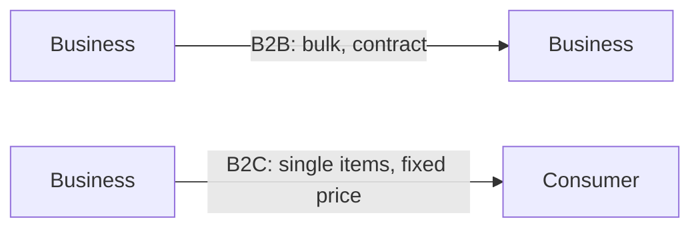
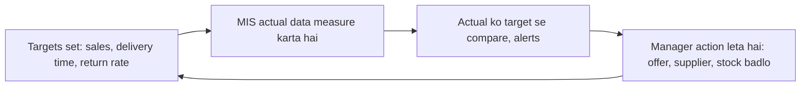

**Ek line mein:** <mark>B2B (business to business) matlab ek business doosre business ko becheti hai; B2C (business to consumer) matlab business individual customers ko becheti hai</mark>, aur MIS dono ko data collect karke, results ko targets se compare karke aur alerts dekar control karta hai. <Cite id="e-commerce-tp-b2b" /> <Cite id="e-commerce-tp-b2c" />

<Box kind="key">

**B2B aur B2C with MIS mein ye points likho:**

- <mark>B2B: business business ko becheti hai</mark>, bulk orders, long-term relationship, contract price. Examples: Infosys bank ko, IndiaMART, Walmart aur uske suppliers.
- <mark>B2C: business individual customers ko becheti hai</mark>, single items, fixed price, quick decision. Examples: Amazon, Flipkart, Zomato.
- Comparison table: buyer, order size, decision, price, payment, systems.
- <mark>MIS contribution: data collect, process, report karta hai, aur managers ko plan, measure, compare, act se control karne deta hai</mark>.
- B2C MIS: customer aur order database, recommendations, fraud detection, abandoned-cart reports.
- B2B MIS: e-procurement, **EDI**, stock sharing, supplier performance reports.

</Box>

## Core answer (5 marks, yahan ke har question ke liye)

<Box kind="definition">

**B2B** e-commerce is trade between two businesses (a maker buying parts, a firm buying cloud services). **B2C** e-commerce is trade between a business and individual consumers (a customer buying a phone online). The model is decided by *who sells to whom*. <Cite id="e-commerce-tp-models" /> <Cite id="e-commerce-gfg-types" />

</Box>

| Point | B2B | B2C |
|---|---|---|
| Buyer | Doosra business | Individual customer |
| Order size | Bada, bulk | Chhota, single items |
| Decision | Dhyan se, kai log | Quick, price aur reviews pe |
| Price | Negotiated, contract rate | Fixed list price, discounts |
| Relationship | Long-term | Short-term, mass market |
| Payment | Credit terms, invoices | Card, UPI, wallet, COD |
| Systems | EDI, ERP links, supplier portals | Website, app, cart, payment gateway |
| Example | Walmart supplier se kharidta hai | Flipkart pe phone kharidna |

<Cite id="e-commerce-tp-b2b" /> <Cite id="e-commerce-tp-b2c" /> <Cite id="e-commerce-gfg-types" />

**Examples:** **B2C** Amazon, Flipkart, Myntra, Zomato. **B2B** Infosys bank ko services, IndiaMART, car maker parts suppliers se kharidta hai.

**Conclusion:** <mark>MIS dono models ke peeche ka system hai; ye managers ko sales, stock, suppliers aur fraud track aur control karne deta hai</mark>.

## Extended answer (10 marks): ye add karo

### 1. Har model ke types

- **B2B types:** *supplier-oriented* (ek supplier kai buyers ko), *buyer-oriented* (bada buyer kai suppliers se bid maangta hai) aur *intermediary* marketplaces jaise IndiaMART. <Cite id="e-commerce-wiki-marketplace" />
- **B2C types:** direct sellers (brand ki apni site), marketplaces (Amazon, Flipkart), service providers (banking, travel) aur content providers (Netflix). <Cite id="e-commerce-tp-b2c" />

### 2. In models ko control karne mein MIS ka contribution

MIS data collect, store, process aur report karta hai, aur front end (website) ko back end (stock, accounts, delivery) se jodta hai. Control ek loop hai: **plan, measure, compare, act**. <Cite id="e-commerce-laudon-mis" /> <Cite id="e-commerce-rainer-intro-is" />

**B2C example: Flipkart ya Amazon.** MIS contribution:

- Har order track karne ke liye customer aur order database.
- Sales badhane ke liye recommendation engine aur personal offers.
- Fraud detection (ajeeb orders, kai failed payments).
- Return aur refund tracking.
- Dashboards: daily sales, **cart abandonment**, delivery time, ratings.

**B2B example: Walmart aur uske suppliers, ya parts kharidne wala car maker.** MIS contribution:

- Requests, bids aur orders ke liye **e-procurement** portal.
- **EDI** se purchase orders, invoices aur shipping notices bina paper ke. <Cite id="e-commerce-wiki-edi" />
- Real-time stock sharing taaki suppliers automatically restock karein.
- Contract, price aur credit-limit records.
- Supplier performance reports (quality, delay, price) taaki achhe suppliers chuno aur rakho.

| Point | B2C control | B2B control |
|---|---|---|
| Main sawal | Customers kharid rahe hain aur khush hain? | Suppliers aur buyers contract pe deliver kar rahe hain? |
| Key reports | Sales, abandoned carts, returns, ratings | Contract ke against orders, supplier delay, credit use |
| Main risk | Payment fraud, fake reviews | Late supply, price disputes, data leak |

### 3. Yahan MIS ke advantages

Tez orders, kam errors, stock aur customers ka ek view, problems ki early warning, behtar supplier choice aur kam cost.

## Har question mein kaise fit karein

- **"Give examples of B2B and B2C Business Models and contribution of MIS to control these models."** (10 marks) <PYQ id="2025-05-ce/q5b" />: definitions aur examples (core), B2B versus B2C table, phir **section 2 poora**: control loop, B2C aur B2B MIS lists aur control table. Real examples ke naam rakho.

## Exam tips

- **B2B versus B2C table aur control-loop diagram draw karo**.
- Har model ke **do real examples** do (Flipkart, Amazon; IndiaMART, Walmart suppliers).
- "Control" matlab plan, measure, compare, act: ye chaar words answer mein use karo.

Exam mein English mein likho.
