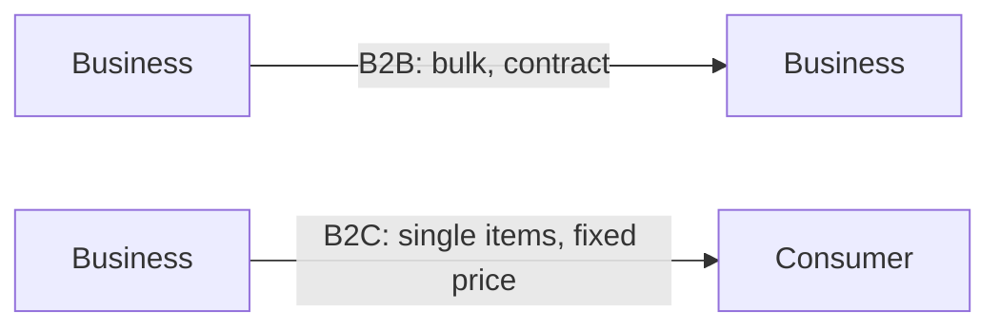
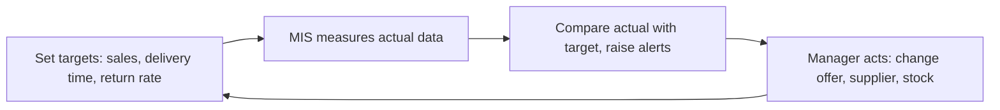

**In one line:** <mark>B2B (business to business) is one business selling to another business; B2C (business to consumer) is a business selling to individual customers</mark>, and MIS controls both by collecting data, comparing results with targets and raising alerts. <Cite id="e-commerce-tp-b2b" /> <Cite id="e-commerce-tp-b2c" />

<Box kind="key">

**Key points to write (B2B and B2C with MIS):**

- <mark>B2B: business sells to business</mark>, bulk orders, long-term relationship, contract price. Examples: Infosys to a bank, IndiaMART, Walmart and its suppliers.
- <mark>B2C: business sells to individual customers</mark>, single items, fixed price, quick decision. Examples: Amazon, Flipkart, Zomato.
- A comparison table: buyer, order size, decision, price, payment, systems.
- <mark>MIS contribution: collects data, processes it, reports it, and lets managers control by plan, measure, compare, act</mark>.
- B2C MIS: customer and order database, recommendations, fraud detection, abandoned-cart reports.
- B2B MIS: e-procurement, **EDI**, stock sharing, supplier performance reports.

</Box>

## Core answer (5 marks, fits every question here)

<Box kind="definition">

**B2B** e-commerce is trade between two businesses (a maker buying parts, a firm buying cloud services). **B2C** e-commerce is trade between a business and individual consumers (a customer buying a phone online). The model is decided by *who sells to whom*. <Cite id="e-commerce-tp-models" /> <Cite id="e-commerce-gfg-types" />

</Box>

| Point | B2B | B2C |
|---|---|---|
| Buyer | Another business | Individual customer |
| Order size | Large, bulk | Small, single items |
| Decision | Careful, several people | Quick, based on price and reviews |
| Price | Negotiated, contract rate | Fixed list price, discounts |
| Relationship | Long-term | Short-term, mass market |
| Payment | Credit terms, invoices | Card, UPI, wallet, COD |
| Systems | EDI, ERP links, supplier portals | Website, app, cart, payment gateway |
| Example | Walmart buying from a supplier | Buying a phone on Flipkart |

<Cite id="e-commerce-tp-b2b" /> <Cite id="e-commerce-tp-b2c" /> <Cite id="e-commerce-gfg-types" />

**Examples:** **B2C** Amazon, Flipkart, Myntra, Zomato. **B2B** Infosys selling services to a bank, IndiaMART, a car maker buying from parts suppliers.

**Conclusion:** <mark>MIS is the system behind both models; it lets managers track and control sales, stock, suppliers and fraud</mark>.

## Extended answer (10 marks): add these

### 1. Types of each model

- **B2B types:** *supplier-oriented* (one supplier sells to many buyers), *buyer-oriented* (a big buyer asks many suppliers to bid) and *intermediary* marketplaces such as IndiaMART. <Cite id="e-commerce-wiki-marketplace" />
- **B2C types:** direct sellers (a brand's own site), marketplaces (Amazon, Flipkart), service providers (banking, travel) and content providers (Netflix). <Cite id="e-commerce-tp-b2c" />

### 2. Contribution of MIS to control these models

MIS collects, stores, processes and reports data, and connects the front end (website) to the back end (stock, accounts, delivery). Control works as a loop: **plan, measure, compare, act**. <Cite id="e-commerce-laudon-mis" /> <Cite id="e-commerce-rainer-intro-is" />

**B2C example: Flipkart or Amazon.** MIS contribution:

- Customer and order database to track every order.
- Recommendation engine and personal offers to raise sales.
- Fraud detection (strange orders, many failed payments).
- Return and refund tracking.
- Dashboards: daily sales, **cart abandonment**, delivery time, ratings.

**B2B example: Walmart and its suppliers, or a car maker buying parts.** MIS contribution:

- **E-procurement** portal for requests, bids and orders.
- **EDI** to exchange purchase orders, invoices and shipping notices without paper. <Cite id="e-commerce-wiki-edi" />
- Real-time stock sharing so suppliers restock automatically.
- Contract, price and credit-limit records.
- Supplier performance reports (quality, delay, price) to choose and keep good suppliers.

| Point | B2C control | B2B control |
|---|---|---|
| Main question | Are customers buying and happy? | Are suppliers and buyers delivering on contract? |
| Key reports | Sales, abandoned carts, returns, ratings | Orders against contract, supplier delay, credit use |
| Main risk watched | Payment fraud, fake reviews | Late supply, price disputes, data leak |

### 3. Advantages of using MIS here

Faster orders, fewer errors, one view of stock and customers, early warning of problems, better supplier choice and lower cost.

## Fit it to each question

- **"Give examples of B2B and B2C Business Models and contribution of MIS to control these models."** (10 marks) <PYQ id="2025-05-ce/q5b" />: definitions and examples (core), the B2B versus B2C table, then **section 2 in full**: the control loop, the B2C and B2B MIS lists and the control table. Keep the real examples named.

## Exam tips

- **Draw the B2B versus B2C table and the control-loop diagram**.
- Name **two real examples for each** model (Flipkart, Amazon; IndiaMART, Walmart suppliers).
- "Control" means plan, measure, compare, act: use these four words in the answer.
