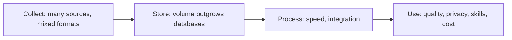
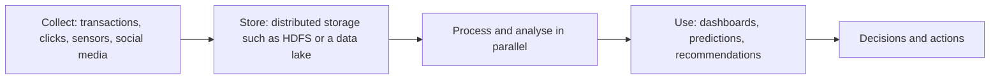

**Ek line mein:** <mark>Big data itna bada, tez ya alag-alag type ka data hai ki traditional software use aasani se capture, store aur analyse nahi kar sakta; iski characteristics V's hain aur challenges storage, speed, integration, quality, privacy aur skills hain</mark>. <Cite id="data-management-wiki-big-data" />

<Box kind="key">

**Ye points likho:**

- <mark>Big data = data sets jo traditional tools ke liye bahut bade, tez ya varied hain</mark>; NIST kehta hai naye scalable architectures chahiye. <Cite id="data-management-nist-bigdata-defs" />
- <mark>Characteristics: Volume, Velocity, Variety</mark> (3 V's), plus **Veracity, Value, Variability**.
- <mark>Challenges: storage, processing speed, integration, quality, privacy aur security, skills, cost</mark>.
- Sources: retail, social media, e-commerce clicks, sensors aur IoT, banks, hospitals.
- Tools: **Hadoop**, distributed storage, data lakes, cloud.
- Books mein 3, 5 ya 6 V's milte hain; explain karo to sab theek.

</Box>

## Core answer (5 marks, yahan ke har question ke liye)

<Box kind="definition">

**Big data** is a collection of data sets so large, fast-arriving or varied that traditional software cannot capture, store and analyse them easily. <Cite id="data-management-wiki-big-data" /> <Cite id="data-management-ibm-big-data" />

</Box>

School canteen 200 students ko ek counter se khila deti hai, lekin 50,000 logon ke stadium ke liye bilkul alag system chahiye.

| V | Matlab | Example |
|---|---|---|
| Volume | Bahut bada, terabytes se petabytes | Supermarket chain ki saalon ki har sale |
| Velocity | Bahut tez aata hai, near real-time handling | Card payments ka fraud check turant |
| Variety | Structured, semi-structured, unstructured | Sales rows, reviews, photos, sensor readings |
| Veracity | Kitna accurate aur bharosemand | Fake reviews, duplicate records |
| Value | Kaam ka insight | Better recommendations |
| Variability | Meaning ya flow badalta hai | Sale ke time traffic spike |

<Cite id="data-management-gfg-6vs" />

**Conclusion:** <mark>big data rich resource hai, lekin sirf wo firms use better decisions mein badalti hain jo ise achhe se store, clean aur analyse kar sakein</mark>.

## Extended answer (10 marks): ye add karo

### 1. Big data ke challenges

1. **Storage:** volume ordinary databases ke scale hone se tez badhta hai.
2. **Processing speed:** data aate hi analyse karne ke liye Hadoop jaise naye tools chahiye. <Cite id="data-management-hadoop" />
3. **Integration:** tables, text, images aur logs ko jodna mushkil.
4. **Quality (veracity):** gandha, duplicate ya untrusted data galat results deta hai.
5. **Privacy aur security:** zyadatar data personal hota hai.
6. **Skills shortage:** data scientists aur engineers kam hain.
7. **Cost aur value:** agar useful insight na mile to storage ka kharcha waste. <Cite id="data-management-aws-big-data" />

### 2. Sources aur life cycle

**Sources:** retail transactions (Walmart), social media, e-commerce clicks (Amazon, Flipkart), food delivery (Zomato), IoT sensors, bank aur stock-market data, hospital scans.

### 3. Uses

Amazon products recommend karta hai, banks fraud pakadte hain, hospitals disease trends predict karte hain, Zomato delivery routes plan karta hai. <Cite id="data-management-sas-big-data" />

## Har question mein kaise fit karein

- **"What is Big Data? What are the various challenges and characteristics of Big Data?"** (10 marks) <PYQ id="2022-12-ce/q6a" /> <PYQ id="2023-05-ce/q4a" />: definition, V's table (kam se kam pehle teen, phir teen aur), saat challenges, life-cycle diagram, uses ki ek line.

## Exam tips

- **Teen V axes ya life-cycle flow draw karo**.
- **Pehle 3 V's** likho, phir Veracity, Value, Variability "extended V's" ki tarah.
- **Har V ka ek example** aur **har challenge ki ek line** do.

Exam mein English mein likho.
