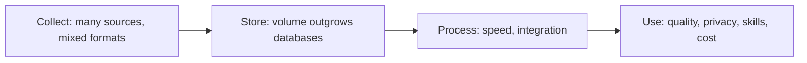
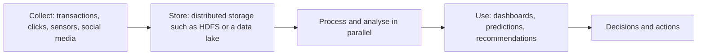

**In one line:** <mark>Big data is data so large, fast-arriving or varied that traditional software cannot capture, store and analyse it easily; its characteristics are the V's and its challenges are storage, speed, integration, quality, privacy and skills</mark>. <Cite id="data-management-wiki-big-data" />

<Box kind="key">

**Key points to write:**

- <mark>Big data = data sets too large, fast or varied for traditional tools</mark>; NIST says new scalable architectures are needed. <Cite id="data-management-nist-bigdata-defs" />
- <mark>Characteristics: Volume, Velocity, Variety</mark> (3 V's), plus **Veracity, Value, Variability**.
- <mark>Challenges: storage, processing speed, integration, quality, privacy and security, skills, cost</mark>.
- Sources: retail, social media, e-commerce clicks, sensors and IoT, banks, hospitals.
- Tools: **Hadoop**, distributed storage, data lakes, cloud.
- Different books count 3, 5 or 6 V's; all are fine if explained.

</Box>

## Core answer (5 marks, fits every question here)

<Box kind="definition">

**Big data** is a collection of data sets so large, fast-arriving or varied that traditional software cannot capture, store and analyse them easily. <Cite id="data-management-wiki-big-data" /> <Cite id="data-management-ibm-big-data" />

</Box>

A school canteen feeds 200 students with one counter, but a stadium of 50,000 people needs a very different system.

| V | Meaning | Example |
|---|---|---|
| Volume | Huge amount, terabytes to petabytes | Years of every sale of a supermarket chain |
| Velocity | Arrives very fast, needs near real-time handling | Card payments checked for fraud as they happen |
| Variety | Structured, semi-structured, unstructured | Sales rows, reviews, photos, sensor readings |
| Veracity | How accurate and trustworthy | Fake reviews, duplicate records |
| Value | Useful insight it gives | Better recommendations |
| Variability | Meaning or flow changes | Traffic spike during a sale |

<Cite id="data-management-gfg-6vs" />

**Conclusion:** <mark>big data is a rich resource, but only firms that can store, clean and analyse it well turn it into better decisions</mark>.

## Extended answer (10 marks): add these

### 1. Challenges of big data

1. **Storage:** volumes grow faster than ordinary databases can scale.
2. **Processing speed:** analysing data as it arrives needs new tools such as Hadoop. <Cite id="data-management-hadoop" />
3. **Integration:** combining tables, text, images and logs is hard.
4. **Quality (veracity):** dirty, duplicate or untrusted data gives wrong results.
5. **Privacy and security:** much of the data is personal.
6. **Skills shortage:** data scientists and engineers are scarce.
7. **Cost and value:** storage spending is wasted if no useful insight is found. <Cite id="data-management-aws-big-data" />

### 2. Sources and life cycle

**Sources:** retail transactions (Walmart), social media, e-commerce clicks (Amazon, Flipkart), food delivery (Zomato), IoT sensors, bank and stock-market data, hospital scans.

### 3. Uses

Amazon recommends products, banks detect fraud, hospitals predict disease trends, Zomato plans delivery routes. <Cite id="data-management-sas-big-data" />

## Fit it to each question

- **"What is Big Data? What are the various challenges and characteristics of Big Data?"** (10 marks) <PYQ id="2022-12-ce/q6a" /> <PYQ id="2023-05-ce/q4a" />: definition, V's table (at least the first three, then three more), the seven challenges, life-cycle diagram, one use line.

## Exam tips

- **Draw** the three V axes or the life-cycle flow.
- Write **3 V's first**, then add Veracity, Value, Variability as "extended V's".
- Give one **example per V** and one **line per challenge**.
