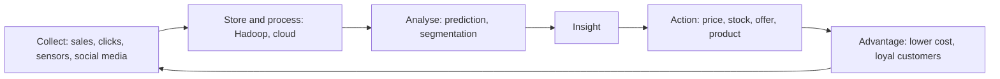

**Ek line mein:** <mark>Company ko big data se competitive advantage tab milta hai jab wo bade, tez aur varied data ko analyse karke wo patterns dekhti hai jo rivals nahi dekh sakte, aur us insight ko jaldi action mein badalti hai</mark>. <Cite id="data-management-ibm-big-data" />

<Box kind="key">

**Ye points likho:**

- <mark>Competitive advantage = jo firm ko rivals se behtar banaye: kam cost, better product, faster service</mark>.
- <mark>Big data: collect, store aur process, analyse, insight, action, advantage</mark>.
- <mark>Uses: customers ko jaano, events predict karo, cost kam karo, jaldi decide karo, experiments, dynamic pricing, naye products, risk manage</mark>.
- Strategy se map karo: **low cost**, **differentiation**, **customer focus**.
- <mark>Advantage tab aata hai jab insight action banta hai</mark>.
- Limits: skilled log, cost, kharab data, privacy aur legal issues.

</Box>

## Core answer (5 marks, yahan ke har question ke liye)

<Box kind="definition">

**Big data** is data so large, fast and varied (clicks, videos, sensor readings, transactions) that ordinary tools cannot handle it. **Competitive advantage** is anything that lets a firm do better than rivals, such as lower cost, a better product or faster service. <Cite id="data-management-ibm-big-data" /> <Cite id="it-impact-society-wiki-competitive-advantage" />

</Box>

Ek dukaandaar jo har customer ki aadat yaad rakhta hai, bas ye lakhon customers ke liye.

**Company big data ka use kaise kar sakti hai**

1. **Customers ko behtar jaano:** bahut chhote segments aur personal offers. Amazon aur Flipkart "customers who bought this also bought" dikhate hain. <Cite id="data-management-sas-big-data" />
2. **Events predict karo:** demand forecast, kharab hone wali machines pehchano, fraud jaldi pakdo.
3. **Cost kam karo:** stock, routes, staffing optimize. Walmart kam stock rakhke bhi shelves bhari rakhta hai.
4. **Jaldi decide karo:** near real-time dashboards. <Cite id="data-management-aws-big-data" />

**Conclusion:** <mark>big data advantage tab deta hai jab firm insight ko jaldi action mein badle; sirf data jama karna kaafi nahi</mark>.

## Extended answer (10 marks): ye add karo

### 1. Advantage ke aur tareeke

5. **Experiments chalao:** web page ya price ke do versions test karo, jeetne wala rakho.
6. **Dynamic pricing:** demand ke saath price badlo, jaise airlines aur ride apps.
7. **Naye products aur business models:** jaise driving data se tay hone wala usage-based insurance.
8. **Risk manage karo:** banks unusual transactions real time mein flag karte hain.

### 2. Strategy se link

| Strategy | Big data use | Example |
|---|---|---|
| Low cost | Demand forecast, route planning | Walmart, Zomato delivery routes |
| Differentiation | Personal offers, naye features | Amazon recommendations |
| Customer focus | Feedback aur social media analysis | Telecom firms churn kam karti hain |

### 3. Saboot

Data-driven decision making mein industry ke top third companies average mein competitors se 5 percent zyada productive aur 6 percent zyada profitable thi. <Cite id="web-mis-1-hbr-big-data-revolution" />

### 4. Limitations

Skilled log aur costly systems chahiye, kharab data galat jawab deta hai, aur personal data use karne se privacy aur legal issues aate hain.

## Har question mein kaise fit karein

- **"Highlight how company can use Big data to gain competitive advantage?"** (10 marks) <PYQ id="2024-12-ce/q3b" />: dono terms ki definition, flow diagram, aath uses (core 1 se 4 plus section 1), strategy table, saboot aur limitations.

## Exam tips

- **Data-se-advantage loop draw karo**.
- **Naam wale examples** do: Amazon, Walmart, Zomato, airlines.
- Saaf likho ki advantage **action** se aata hai, sirf data se nahi.

Exam mein English mein likho.
