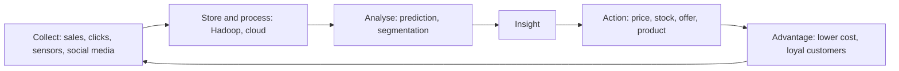

**In one line:** <mark>A company gains competitive advantage from big data when it analyses huge, fast and varied data to see patterns its rivals cannot, and turns that insight into quick action</mark>. <Cite id="data-management-ibm-big-data" />

<Box kind="key">

**Key points to write:**

- <mark>Competitive advantage = anything that lets a firm do better than rivals: lower cost, better product, faster service</mark>.
- <mark>Big data: collect, store and process, analyse, insight, action, advantage</mark>.
- <mark>Uses: know customers, predict events, cut cost, decide faster, run experiments, dynamic pricing, new products, manage risk</mark>.
- Map to strategy: **low cost**, **differentiation**, **customer focus**.
- <mark>Advantage comes only when insight is turned into action</mark>.
- Limits: skilled people, cost, poor data, privacy and legal issues.

</Box>

## Core answer (5 marks, fits every question here)

<Box kind="definition">

**Big data** is data so large, fast and varied (clicks, videos, sensor readings, transactions) that ordinary tools cannot handle it. **Competitive advantage** is anything that lets a firm do better than rivals, such as lower cost, a better product or faster service. <Cite id="data-management-ibm-big-data" /> <Cite id="it-impact-society-wiki-competitive-advantage" />

</Box>

Think of a shopkeeper who remembers every customer's habits, but for millions of customers.

**How a company can use big data**

1. **Know customers better:** very small segments and personal offers. Amazon and Flipkart show "customers who bought this also bought". <Cite id="data-management-sas-big-data" />
2. **Predict events:** forecast demand, spot machines likely to fail, detect fraud early.
3. **Cut cost:** optimize stock, routes and staffing. Walmart keeps shelves stocked while holding less stock.
4. **Decide faster:** near real-time dashboards. <Cite id="data-management-aws-big-data" />

**Conclusion:** <mark>big data gives an advantage only when the firm turns insight into quick action; collecting data alone is not enough</mark>.

## Extended answer (10 marks): add these

### 1. More ways to gain advantage

5. **Run experiments:** test two versions of a web page or price and keep the winner.
6. **Dynamic pricing:** change prices with demand, as airlines and ride apps do.
7. **New products and business models:** for example, usage-based insurance priced from driving data.
8. **Manage risk:** banks flag unusual transactions in real time.

### 2. Link to strategy

| Strategy | Big data use | Example |
|---|---|---|
| Low cost | Demand forecast, route planning | Walmart, Zomato delivery routes |
| Differentiation | Personal offers, new features | Amazon recommendations |
| Customer focus | Feedback and social media analysis | Telecom firms reduce churn |

### 3. Evidence

Companies in the top third of their industry in data-driven decision making were, on average, 5 percent more productive and 6 percent more profitable than their competitors. <Cite id="web-mis-1-hbr-big-data-revolution" />

### 4. Limitations

Needs skilled people and costly systems, poor data gives wrong answers, and using personal data raises privacy and legal issues.

## Fit it to each question

- **"Highlight how company can use Big data to gain competitive advantage?"** (10 marks) <PYQ id="2024-12-ce/q3b" />: definition of both terms, the flow diagram, the eight uses (core 1 to 4 plus section 1), the strategy table, evidence and limitations.

## Exam tips

- **Draw** the data-to-advantage loop.
- Give **named examples**: Amazon, Walmart, Zomato, airlines.
- Say clearly that **action** creates the advantage, not data alone.
