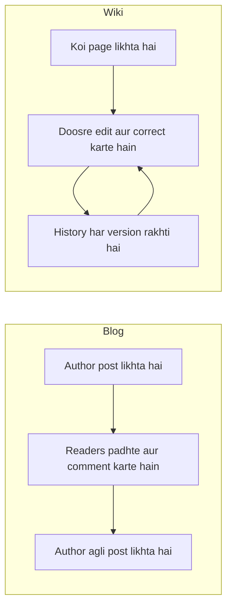

**Ek line mein:** Haan, ye alag hain: <mark>blog batane ke liye hai (ek author dated posts likhta hai, readers comment karte hain), wiki milke banane ke liye hai (kai log same pages edit karte hain aur har change save hota hai)</mark>. Dono Web 2.0 tools hain. <Cite id="social-computing-wiki-blog" /> <Cite id="social-computing-wiki-wiki" />

<Box kind="key">

**Blogs versus wikis mein ye points likho:**

- <mark>Blog: dated posts ki website, newest pehle, aam taur pe ek author, neeche comments</mark>.
- <mark>Wiki: aise pages jinhe permission wala koi bhi edit kar sakta hai; har change history mein save hota hai</mark>.
- Farq: **authors** (ek versus kai), **main text kaun edit karta hai** (sirf author versus permission wala koi bhi), **order** (dated versus linked pages), **voice** (personal versus neutral).
- Purpose: blog = batana aur marketing; wiki = milke knowledge banana.
- **Har ka application:** company blog news share aur customers laane ke liye; internal wiki manuals, FAQs aur project notes ke liye.
- Examples: WordPress aur Blogger blogs; Wikipedia aur Confluence.

</Box>

## Core answer (5 marks, yahan ke har question ke liye)

<Box kind="definition">

A **blog** is a website of dated posts, newest first, usually written by one person or a small team, with a comment section for readers. A **wiki** is a website whose pages can be edited by many users, and every change is saved in a version history. <Cite id="social-computing-wiki-blog" /> <Cite id="social-computing-wiki-wiki" />

</Box>

| Point | Blog | Wiki |
|---|---|---|
| Authors | Ek person ya chhoti team | Kai contributors |
| Main text kaun edit karta hai | Sirf author; readers comment likhte hain | Permission wala koi bhi kisi bhi page ko edit kar sakta hai |
| Order | Dated posts, newest pehle | Linked pages, date order nahi |
| Voice | Personal opinion aur kahani | Neutral, shared knowledge |
| Purpose | Batana, marketing, following banana | Milke knowledge ka bhandar banana |
| Version history | Main feature nahi | Har edit save, undo ho sakta hai |
| Example | WordPress, Blogger | Wikipedia, Confluence |

**Har ka application:**

- **Blog:** company blog naye products samjhata hai aur customers laata hai (marketing); food blogger restaurants review karta hai.
- **Wiki:** company internal wiki mein manuals, FAQs aur project notes rakhti hai taaki staff know-how share kare.

**Conclusion:** <mark>blog batane ke baare mein hai; wiki milke banane ke baare mein</mark>.

## Extended answer (10 marks): ye add karo

### 1. Features detail mein

- **Blog:** posts, categories aur tags, comments, RSS feed jisse readers ko nayi posts ek reader mein milti hain, doosre blogs ke links. **Microblog** (X, Threads) bahut chhoti posts wala blog hai. <Cite id="social-computing-wiki-microblogging" />
- **Wiki:** aasan editing, pages ke beech links, versions ki **history aur compare**, undo, discussion pages, access control.

### 2. Business use

| Use | Blog | Wiki |
|---|---|---|
| Marketing | Product news, stories, customers attract | Main use nahi |
| Knowledge sharing | Leader ke views staff ko | Manuals, procedures, FAQs |
| Customer service | Updates aur announcements | Self-help help-pages |
| Control | Comments moderate karo | Kaun edit kare set karo, history check karo |

### 3. Advantages aur limits

| | Blog | Wiki |
|---|---|---|
| Advantages | Shuru karna aasan, personal voice, following banata hai | Shared knowledge, hamesha up to date, errors kai log sudharte hain |
| Limits | One-sided, regular posting chahiye | Vandalism ya galat edits, moderation chahiye |

Dono **Web 2.0** tools hain kyunki user sirf padhta nahi, likh bhi sakta hai. <Cite id="social-computing-wiki-web2" />

## Har question mein kaise fit karein

- **"Are Blogs and Wikis different? Justify with application of each."** (5 marks) <PYQ id="2024-05-ce/q1d" />: **core answer** likho: "Yes, different", definitions, comparison table (chhe rows), phir **har ka application** aur one-line conclusion.

## Exam tips

- **"Yes, they are different" se shuru karo** kyunki question yahi poochta hai, phir justify karo.
- Har ka **application** zaroor do (company blog, internal wiki); question maangta hai.
- Yaad rakhne ki line: blog = batana, wiki = milke banana.

Exam mein English mein likho.
