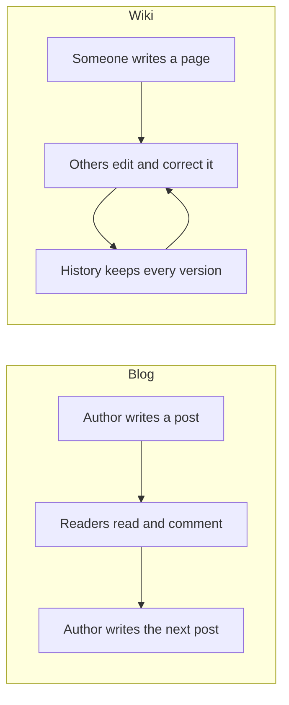

**In one line:** Yes, they are different: <mark>a blog is for telling (one author writes dated posts, readers comment), a wiki is for building together (many people edit the same pages and every change is saved)</mark>. Both are Web 2.0 tools. <Cite id="social-computing-wiki-blog" /> <Cite id="social-computing-wiki-wiki" />

<Box kind="key">

**Key points to write (blogs versus wikis):**

- <mark>Blog: a website of dated posts, newest first, usually by one author, with comments below</mark>.
- <mark>Wiki: pages that anyone allowed can edit; every change is saved in a history</mark>.
- Difference: **authors** (one versus many), **who edits the main text** (only the author versus anyone with permission), **order** (dated versus linked pages), **voice** (personal versus neutral).
- Purpose: blog = telling and marketing; wiki = building knowledge together.
- **Application of each:** company blog to share news and attract customers; internal wiki for manuals, FAQs and project notes.
- Examples: WordPress and Blogger blogs; Wikipedia and Confluence.

</Box>

## Core answer (5 marks, fits every question here)

<Box kind="definition">

A **blog** is a website of dated posts, newest first, usually written by one person or a small team, with a comment section for readers. A **wiki** is a website whose pages can be edited by many users, and every change is saved in a version history. <Cite id="social-computing-wiki-blog" /> <Cite id="social-computing-wiki-wiki" />

</Box>

| Point | Blog | Wiki |
|---|---|---|
| Authors | One person or a small team | Many contributors |
| Who edits the main text | Only the author; readers write comments | Anyone with permission can edit any page |
| Order | Dated posts, newest first | Linked pages, no date order |
| Voice | Personal opinion and story | Neutral, shared knowledge |
| Purpose | Telling, marketing, building a following | Building a body of knowledge together |
| Version history | Not the main feature | Every edit saved and can be undone |
| Example | WordPress, Blogger | Wikipedia, Confluence |

**Application of each:**

- **Blog:** a company blog explains new products and attracts customers (marketing); a food blogger reviews restaurants.
- **Wiki:** a company keeps manuals, FAQs and project notes in an internal wiki so staff share know-how.

**Conclusion:** <mark>a blog is about telling; a wiki is about building together</mark>.

## Extended answer (10 marks): add these

### 1. Features in detail

- **Blog:** posts, categories and tags, comments, RSS feed so readers get new posts in one reader, links to other blogs. A **microblog** (X, Threads) is a blog with very short posts. <Cite id="social-computing-wiki-microblogging" />
- **Wiki:** easy editing, links between pages, **history and compare** of versions, undo, discussion pages, access control.

### 2. Business use

| Use | Blog | Wiki |
|---|---|---|
| Marketing | Product news, stories, customer attraction | Not the main use |
| Knowledge sharing | Leader's views to staff | Manuals, procedures, FAQs |
| Customer service | Updates and announcements | Self-help help-pages |
| Control | Moderate comments | Set who can edit, check history |

### 3. Advantages and limits

| | Blog | Wiki |
|---|---|---|
| Advantages | Easy to start, personal voice, builds a following | Shared knowledge, always up to date, errors corrected by many |
| Limits | One-sided, needs regular posting | Vandalism or wrong edits, needs moderation |

Both are **Web 2.0** tools because the user can write, not only read. <Cite id="social-computing-wiki-web2" />

## Fit it to each question

- **"Are Blogs and Wikis different? Justify with application of each."** (5 marks) <PYQ id="2024-05-ce/q1d" />: write the **core answer**: "Yes, different", definitions, the comparison table (six rows), then one **application of each** and the one-line conclusion.

## Exam tips

- **Start with "Yes, they are different"** because the question asks it, then justify.
- Always give the **application** of each (company blog, internal wiki); the question asks for it.
- Remember the memory line: blog = telling, wiki = building together.
