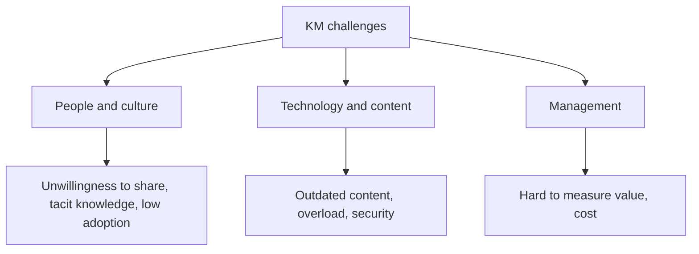

**Ek line mein:** <mark>Zyadatar KM challenges technology se nahi, logon aur culture se aate hain: employees share nahi karna chahte, tacit knowledge capture karna mushkil, content purana ho jaata hai aur value napna mushkil</mark>. <Cite id="knowledge-management-tp-challenges" />

<Box kind="key">

**Ye points likho:**

- <mark>KM = knowledge create, capture, store, share aur use karne ke processes aur tools</mark>.
- <mark>Challenges: share karne ki unwillingness, tacit knowledge, outdated content, security vs sharing, value napna, adoption, information overload</mark>.
- Root cause: **busy insaan sharing mein time kyun lagaye?** Culture, rewards aur easy tools iska jawab hain.
- Challenge **business ke hisaab se** dikhao: manufacturing, IT, banking, healthcare, multinational firms.
- **Indian examples** do: Infosys, TCS, SBI.

</Box>

## Core answer (5 marks, yahan ke har question ke liye)

<Box kind="definition">

**Knowledge management (KM)** is the set of processes and tools used to create, capture, store, share and use an organization's knowledge, so the right person gets the right knowledge at the right time. <Cite id="knowledge-management-ibm" />

</Box>

Sunne mein aasaan lagta hai, lekin bahut KM projects fail hote hain.

**KM ke challenges**

1. **Share karne ki unwillingness:** employees sochte hain "knowledge is power". <Cite id="knowledge-management-tp-challenges" />
2. **Tacit knowledge capture mushkil:** experts jo "bas jaante hain" wo explain nahi kar paate.
3. **Outdated ya galat content:** log repository pe bharosa chhod dete hain.
4. **Security vs sharing:** sensitive designs aur client data restricted hone chahiye.
5. **Value napna:** prove karna mushkil ki project ka fayda hua.
6. **Adoption aur technology change:** tools tab chalte hain jab log use karein.
7. **Information overload:** bahut content mein sahi item dhoondhna mushkil.

**Conclusion:** <mark>zyadatar KM problems ek sawaal pe aati hain: busy insaan jo wo jaanta hai wo share karne mein time kyun lagaye? Culture, rewards aur easy tools iska jawab hain</mark>.

## Extended answer (10 marks): ye add karo

### 1. Alag businesses mein challenges

| Business | Typical KM challenge |
|---|---|
| Manufacturing | Shop-floor skills tacit hain aur retirement ke paas senior workers ke paas |
| IT aur consulting (Infosys, TCS) | Project knowledge bikhra hai aur staff jaane pe kho jaata hai |
| Banking (SBI) | Confidentiality aur regulation sharing ko limit karte hain |
| Healthcare | Clinical guidance tezi se badalti hai; patient privacy sharing rokti hai |
| Multinational firms | Languages, cultures aur time zones sharing slow karte hain |

<Cite id="knowledge-management-wiki-km" /> <Cite id="knowledge-management-rainer-mis" />

### 2. Inhe kaise door karein

- Sharing ko appraisals mein reward karo.
- Tools easy banao aur daily kaam ka hissa banao.
- Purane content ko schedule pe review karke hatao.
- Security aur sharing ke balance ke liye role-based access.
- Simple measures track karo: bacha hua time, reuse count.

## Har question mein kaise fit karein

- **"Explain the challenges faced by Knowledge management in different business"** (5 marks) <PYQ id="2023-12-ce/q1a" />: definition, saat challenges, phir business table (kam se kam teen rows); extended part ka "kaise door karein" optional.

## Exam tips

- **People aur culture** se shuru karo; yahi main point hai.
- "In different business" matlab **business-wise table** zaroor ho.
- Challenges number karke **ek-ek line** mein likho.

Exam mein English mein likho.
