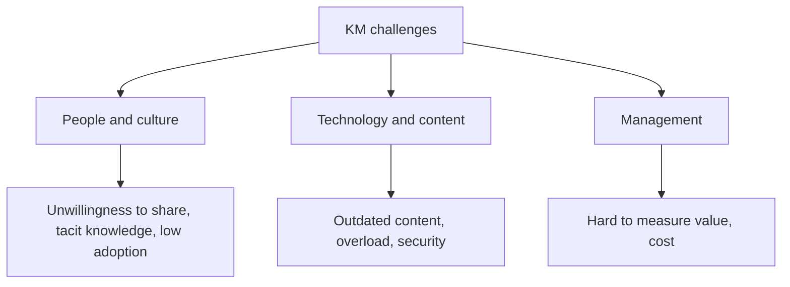

**In one line:** <mark>Most KM challenges come from people and culture, not technology: employees do not want to share, tacit knowledge is hard to capture, content gets outdated and the value is hard to measure</mark>. <Cite id="knowledge-management-tp-challenges" />

<Box kind="key">

**Key points to write:**

- <mark>KM = processes and tools to create, capture, store, share and use knowledge</mark>.
- <mark>Challenges: unwillingness to share, tacit knowledge, outdated content, security versus sharing, measuring value, adoption, information overload</mark>.
- Root cause: **why would a busy person spend time sharing?** Culture, rewards and easy tools answer it.
- Show the challenge **per business**: manufacturing, IT, banking, healthcare, multinational firms.
- Give **Indian examples**: Infosys, TCS, SBI.

</Box>

## Core answer (5 marks, fits every question here)

<Box kind="definition">

**Knowledge management (KM)** is the set of processes and tools used to create, capture, store, share and use an organization's knowledge, so the right person gets the right knowledge at the right time. <Cite id="knowledge-management-ibm" />

</Box>

It sounds easy, but many KM projects fail.

**Challenges of KM**

1. **Unwillingness to share:** employees think "knowledge is power". <Cite id="knowledge-management-tp-challenges" />
2. **Tacit knowledge is hard to capture:** experts cannot explain what they "just know".
3. **Outdated or wrong content:** people stop trusting the repository.
4. **Security versus sharing:** sensitive designs and client data must be restricted.
5. **Measuring value:** hard to prove the project paid off.
6. **Adoption and technology change:** tools work only if people use them.
7. **Information overload:** too much content makes the right item hard to find.

**Conclusion:** <mark>most KM problems come back to one question: why would a busy person spend time sharing what they know? Culture, rewards and easy tools answer it</mark>.

## Extended answer (10 marks): add these

### 1. Challenges in different businesses

| Business | Typical KM challenge |
|---|---|
| Manufacturing | Shop-floor skills are tacit and held by senior workers near retirement |
| IT and consulting (Infosys, TCS) | Project knowledge is scattered and lost when staff move or leave |
| Banking (SBI) | Confidentiality and regulation limit what can be shared |
| Healthcare | Clinical guidance changes fast; patient privacy limits sharing |
| Multinational firms | Languages, cultures and time zones slow sharing |

<Cite id="knowledge-management-wiki-km" /> <Cite id="knowledge-management-rainer-mis" />

### 2. How to overcome them

- Reward sharing in appraisals.
- Make tools easy to use and part of daily work.
- Review and retire old content on a schedule.
- Use role-based access to balance security and sharing.
- Track simple measures such as time saved and reuse count.

## Fit it to each question

- **"Explain the challenges faced by Knowledge management in different business"** (5 marks) <PYQ id="2023-12-ce/q1a" />: definition, the seven challenges, then the business table (at least three rows); the extended part's "how to overcome" is optional.

## Exam tips

- Lead with **people and culture**; it is the main point.
- "In different business" means the **table by business** must be there.
- Number the challenges and keep **one line each**.
