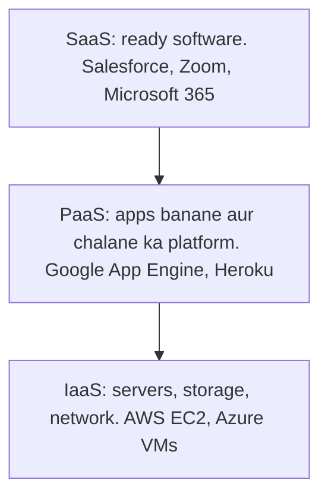
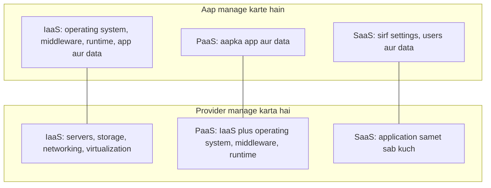
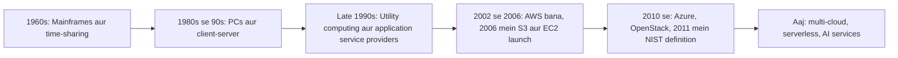

**Ek line mein:** <mark>Cloud computing internet pe computing resources (servers, storage, software) ke shared pool tak on-demand access hai, jitna use karo utna paisa</mark>. Iske service models hain <mark>IaaS, PaaS aur SaaS</mark> (aur CaaS), aur deployment models hain public, private, hybrid aur community. <Cite id="note-cloud-computing-nist-800-145" /> <Cite id="note-cloud-computing-aws-cloud" />

<Box kind="key">

**Cloud model ke har question mein ye points likho:**

- <mark>Cloud computing = configurable computing resources ke shared pool tak on-demand network access, minimal management effort ke saath</mark> (NIST).
- **Paanch characteristics:** on-demand self-service, broad network access, resource pooling, rapid elasticity, measured service.
- <mark>IaaS: servers, storage, network. PaaS: apps banane aur chalane ka platform. SaaS: ready software. CaaS: containers chalane ka platform</mark>.
- Kaun kya manage karta hai: IaaS mein aap zyada, SaaS mein provider sab.
- **Examples:** IaaS AWS EC2; PaaS Google App Engine, Heroku; SaaS Salesforce, Microsoft 365, Zoom; CaaS Amazon ECS, GKE.
- **Deployment:** public, private, hybrid, community.
- **Evolution:** mainframe time-sharing, client-server, utility computing, AWS (2006), aaj ka cloud.

</Box>

## Core answer (5 marks, yahan ke har question ke liye)

<Box kind="definition">

**Cloud computing** is a model for enabling ubiquitous, convenient, on-demand network access to a shared pool of configurable computing resources (for example networks, servers, storage, applications and services) that can be rapidly provisioned and released with minimal management effort. In simple words: you **rent** computing power, storage and software over the internet and pay for what you use. <Cite id="note-cloud-computing-nist-800-145" />

</Box>

**Kyun chahiye:** jo company apne servers kharidti hai wo pehle bahut paisa deti hai, capacity ka andaza lagati hai, chalane ke liye staff rakhti hai aur spare capacity rakhti hai jo khaali padi rehti hai. Cloud fixed cost ko variable cost bana deta hai. Apne servers rakhna gaadi kharidne jaisa hai; cloud Ola ya Uber jaisa hai, ride ke hisaab se paisa. <Cite id="note-cloud-computing-aws-cloud" />

**Service models:**

| Model | Kya milta hai | Examples | Application |
|---|---|---|---|
| **IaaS** (Infrastructure as a Service) | Virtual machines, storage, network | AWS EC2, Azure VMs, Google Compute Engine | Website hosting, backup, testing, traffic spike mein extra capacity |
| **PaaS** (Platform as a Service) | Apps develop, test aur run karne ka platform | Google App Engine, Heroku, Azure App Service | Team servers manage kiye bina code deploy karti hai |
| **SaaS** (Software as a Service) | Subscription pe finished application | Salesforce, Google Workspace, Zoom | Email, CRM, office tools, video meetings |
| **CaaS** (Containers as a Service) | Containers chalane ka platform | Amazon ECS, Google Kubernetes Engine | Microservices, DevOps pipelines |

<Cite id="note-cloud-computing-ibm-models" /> <Cite id="note-cloud-computing-gfg-models" /> <Cite id="note-cloud-computing-ibm-caas" />

**Conclusion:** <mark>cloud computing organisation ko computing utility ki tarah use karne deta hai, jitna use utna paisa</mark>, lekin security, cost aur lock-in ko manage karna padta hai.

## Extended answer (10 marks): ye add karo

### 1. Paanch essential characteristics (NIST)

| Characteristic | Matlab | Example |
|---|---|---|
| On-demand self-service | Resources khud, kabhi bhi lo | Kuch clicks mein virtual server start |
| Broad network access | Kai devices se use | Phone aur laptop pe Google Docs |
| Resource pooling | Ek provider ke resources kai customers mein shared | Ek data center pe kai firms |
| Rapid elasticity | Jaldi badhao ya ghatao | Sale ke din shopping site servers badhati hai |
| Measured service | Usage measure aur bill | Per hour ya per GB paisa |

<Cite id="note-cloud-computing-nist-800-145" />

### 2. Kaun kya manage karta hai

| Point | IaaS | PaaS | SaaS | CaaS |
|---|---|---|---|---|
| Main users | IT admins, DevOps | Developers | End users | Developers, DevOps |
| Skill chahiye | Zyada | Medium | Kam | Medium se zyada |
| Main limit | Zyada kaam aur expertise | Kam control, lock-in | Customise kam | Provider dependence, security dhyan |

**Container** application ko uski zaroori libraries ke saath pack karta hai taaki wo har jagah same chale, aur virtual machine se halka hota hai. Kuch papers mein "CAAS" ka matlab Containers as a Service hai, jaisa yahan use hua. <Cite id="note-cloud-computing-gfg-caas" /> <Cite id="web-mis-2-wiki-iaas" /> <Cite id="web-mis-2-wiki-paas" /> <Cite id="web-mis-2-azure-iaas" />

### 3. Deployment models

| Model | Matlab | Example |
|---|---|---|
| Public | Provider ka, kai customers mein shared | AWS pe start-up |
| Private | Sirf ek organisation ke liye | Bank apne data center mein |
| Hybrid | Private aur public juda hua | Retailer customer records private rakhta hai aur sale ke liye public capacity rent karta hai |
| Community | Common needs wali organisations mein shared | Compliance wala cloud share karte hospitals |

<Cite id="note-cloud-computing-gfg-deploy" />

### 4. Cloud computing ka evolution

| Stage | Kya tha | Kya problem chhodi |
|---|---|---|
| Time-sharing (1960s) | Users ek central mainframe share karte the | Bahut mehngi machines, users door |
| PCs aur client-server | Har firm ke apne servers aur PCs | Zyada cost, idle capacity |
| Utility computing (late 1990s) | Computing bijli ki tarah rent aur meter | Technology aur internet speed tayyar nahi |
| Cloud (2002 se) | AWS, phir Azure, OpenStack | Security, lock-in, cost control |

Do enablers: **virtualization** (hardware ko kai virtual machines mein todna) aur **utility computing** (metered billing). <Cite id="note-cloud-computing-wiki-cloud" /> <Cite id="note-cloud-computing-wiki-utility" /> <Cite id="note-cloud-computing-tp-cloud" />

### 5. Limits

Security aur privacy, kam control, internet dependence, **vendor lock-in**, cost overruns, migration effort. <Cite id="note-cloud-computing-wiki-cloud" />

## Har question mein kaise fit karein

- **"Describe various Cloud Computing Models and highlight their evolution."** (10 marks) <PYQ id="2022-12-ce/q6b" /> <PYQ id="2023-05-ce/q4b" />: definition, service models (table aur layered diagram), deployment models (section 3), phir **section 4 poora** (timeline diagram aur stage table); end mein limits line.
- **"What is Cloud Computing? Explain its models."** (10 marks) <PYQ id="2023-12-ce/q4a" /> <PYQ id="2025-05-ce/q6b" />: definition, why needed, **paanch characteristics (section 1)**, who-manages diagram ke saath service models (section 2), deployment models (section 3) aur conclusion. Timeline chhod do.
- **"What do you mean by CAAS, SAAS, IASS? Give the application of each of these."** (10 marks) <PYQ id="2024-05-ce/q2b" />: full form, meaning, kaun kya manage karta hai, **har ke do examples aur do applications** (core table ki har row ko 3 lines mein badhao), phir IaaS/PaaS/SaaS/CaaS comparison table. Likho ki CAAS matlab Containers as a Service.

## Exam tips

- **Layered IaaS, PaaS, SaaS diagram draw karo** aur real examples ke naam do (AWS, Google App Engine, Salesforce).
- Idea na aaye to **kitchen analogy** use karo: IaaS khaali kitchen, PaaS tools wali kitchen, SaaS tayyar khana.
- "Evolution" mein sirf dates nahi, **har stage ka ek-line cause aur effect** likho.

Exam mein English mein likho.
