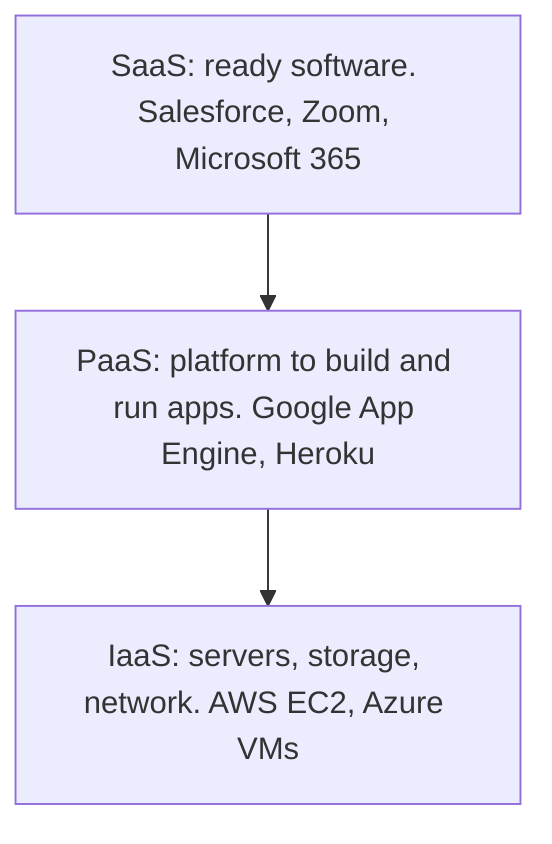
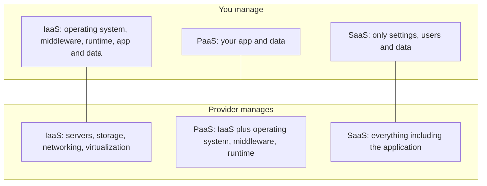
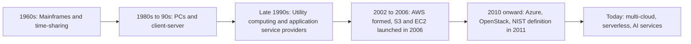

**In one line:** <mark>Cloud computing is on-demand access to a shared pool of computing resources (servers, storage, software) over the internet, paid for as used</mark>. Its service models are <mark>IaaS, PaaS and SaaS</mark> (and CaaS), and its deployment models are public, private, hybrid and community. <Cite id="note-cloud-computing-nist-800-145" /> <Cite id="note-cloud-computing-aws-cloud" />

<Box kind="key">

**Key points to write (any cloud model question):**

- <mark>Cloud computing = on-demand network access to a shared pool of configurable computing resources, with minimal management effort</mark> (NIST).
- **Five characteristics:** on-demand self-service, broad network access, resource pooling, rapid elasticity, measured service.
- <mark>IaaS: servers, storage, network. PaaS: platform to build and run apps. SaaS: ready software. CaaS: platform to run containers</mark>.
- Who manages what: in IaaS you manage most, in SaaS the provider manages everything.
- **Examples:** IaaS AWS EC2; PaaS Google App Engine, Heroku; SaaS Salesforce, Microsoft 365, Zoom; CaaS Amazon ECS, GKE.
- **Deployment:** public, private, hybrid, community.
- **Evolution:** mainframe time-sharing, client-server, utility computing, AWS (2006), cloud today.

</Box>

## Core answer (5 marks, fits every question here)

<Box kind="definition">

**Cloud computing** is a model for enabling ubiquitous, convenient, on-demand network access to a shared pool of configurable computing resources (for example networks, servers, storage, applications and services) that can be rapidly provisioned and released with minimal management effort. In simple words: you **rent** computing power, storage and software over the internet and pay for what you use. <Cite id="note-cloud-computing-nist-800-145" />

</Box>

**Why it is needed:** a company that buys its own servers pays a lot first, must guess its capacity, hires staff to run them and keeps spare capacity that sits idle. Cloud turns that fixed cost into a variable cost. Owning servers is like owning a car; cloud is like using Ola or Uber and paying per ride. <Cite id="note-cloud-computing-aws-cloud" />

**Service models:**

| Model | What you get | Examples | Application |
|---|---|---|---|
| **IaaS** (Infrastructure as a Service) | Virtual machines, storage, network | AWS EC2, Azure VMs, Google Compute Engine | Hosting a website, backup, testing, extra capacity in a traffic spike |
| **PaaS** (Platform as a Service) | Platform to develop, test and run apps | Google App Engine, Heroku, Azure App Service | A team deploys code without managing servers |
| **SaaS** (Software as a Service) | Finished application by subscription | Salesforce, Google Workspace, Zoom | Email, CRM, office tools, video meetings |
| **CaaS** (Containers as a Service) | Platform to run containers | Amazon ECS, Google Kubernetes Engine | Microservices, DevOps pipelines |

<Cite id="note-cloud-computing-ibm-models" /> <Cite id="note-cloud-computing-gfg-models" /> <Cite id="note-cloud-computing-ibm-caas" />

**Conclusion:** <mark>cloud computing lets an organisation use computing as a utility, paying for what it uses</mark>, but it must manage security, cost and lock-in.

## Extended answer (10 marks): add these

### 1. Five essential characteristics (NIST)

| Characteristic | Meaning | Example |
|---|---|---|
| On-demand self-service | Get resources yourself, any time | Start a virtual server in a few clicks |
| Broad network access | Use it from many devices | Google Docs on phone and laptop |
| Resource pooling | One provider's resources shared by many customers | Many firms on one data center |
| Rapid elasticity | Grow or shrink quickly | Shopping site adds servers for a sale day |
| Measured service | Usage measured and billed | Pay per hour or per GB |

<Cite id="note-cloud-computing-nist-800-145" />

### 2. Who manages what

| Point | IaaS | PaaS | SaaS | CaaS |
|---|---|---|---|---|
| Main users | IT admins, DevOps | Developers | End users | Developers, DevOps |
| Skill needed | High | Medium | Low | Medium to high |
| Main limit | More work and expertise | Less control, lock-in | Little customising | Provider dependence, security care |

A **container** packs an application with the libraries it needs so it runs the same everywhere, and is lighter than a virtual machine. In some papers "CAAS" means Containers as a Service, as used here. <Cite id="note-cloud-computing-gfg-caas" /> <Cite id="web-mis-2-wiki-iaas" /> <Cite id="web-mis-2-wiki-paas" /> <Cite id="web-mis-2-azure-iaas" />

### 3. Deployment models

| Model | Meaning | Example |
|---|---|---|
| Public | Owned by a provider, shared by many customers | A start-up on AWS |
| Private | Used by one organisation only | A bank in its own data center |
| Hybrid | Private and public joined | Retailer keeps customer records private and rents public capacity for a sale |
| Community | Shared by organisations with common needs | Hospitals sharing a compliance-bound cloud |

<Cite id="note-cloud-computing-gfg-deploy" />

### 4. Evolution of cloud computing

| Stage | What it was | Problem it left |
|---|---|---|
| Time-sharing (1960s) | Users shared one central mainframe | Very costly machines, users far away |
| PCs and client-server | Each firm owned servers and PCs | High cost, idle capacity |
| Utility computing (late 1990s) | Computing rented and metered like electricity | Technology and internet speed not ready |
| Cloud (2002 onward) | AWS, then Azure, OpenStack | Security, lock-in, cost control |

Two enablers: **virtualization** (splitting hardware into many virtual machines) and **utility computing** (metered billing). <Cite id="note-cloud-computing-wiki-cloud" /> <Cite id="note-cloud-computing-wiki-utility" /> <Cite id="note-cloud-computing-tp-cloud" />

### 5. Limits

Security and privacy, less control, internet dependence, **vendor lock-in**, cost overruns, migration effort. <Cite id="note-cloud-computing-wiki-cloud" />

## Fit it to each question

- **"Describe various Cloud Computing Models and highlight their evolution."** (10 marks) <PYQ id="2022-12-ce/q6b" /> <PYQ id="2023-05-ce/q4b" />: definition, service models (table and layered diagram), deployment models (section 3), then **section 4 in full** (timeline diagram and stage table); end with the limits line.
- **"What is Cloud Computing? Explain its models."** (10 marks) <PYQ id="2023-12-ce/q4a" /> <PYQ id="2025-05-ce/q6b" />: definition, why needed, **five characteristics (section 1)**, service models with the who-manages diagram (section 2), deployment models (section 3) and conclusion. Skip the timeline.
- **"What do you mean by CAAS, SAAS, IASS? Give the application of each of these."** (10 marks) <PYQ id="2024-05-ce/q2b" />: write the full form, meaning, who manages what, **two examples and two applications each** (use the core table and extend each row into 3 lines), then the IaaS/PaaS/SaaS/CaaS comparison table. State that CAAS means Containers as a Service.

## Exam tips

- **Draw the layered IaaS, PaaS, SaaS diagram** and name real examples (AWS, Google App Engine, Salesforce).
- Use the **kitchen analogy** if you are short of ideas: IaaS empty kitchen, PaaS kitchen with tools, SaaS the finished meal.
- When asked for "evolution", write a **one-line cause and effect per stage**, not only dates.
