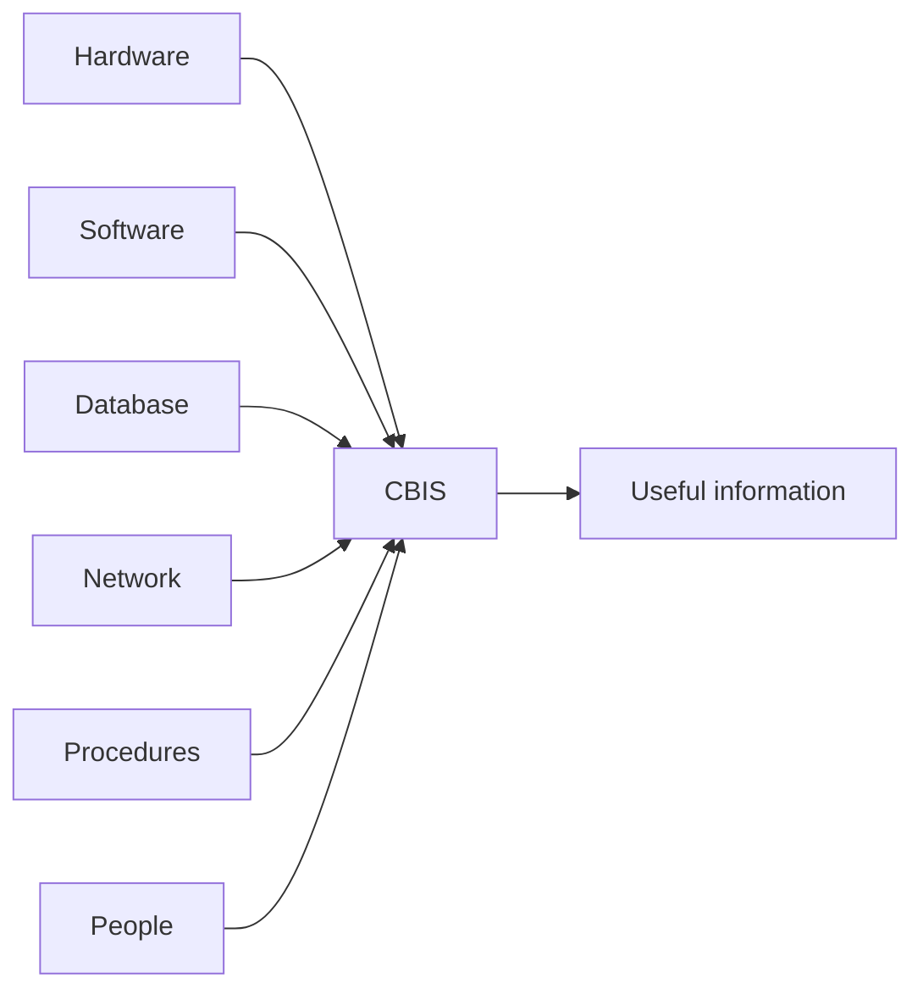
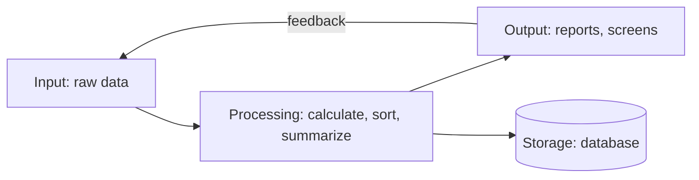

**Ek line mein:** <mark>CBIS ek information system hai jo computer technology (hardware, software, database, network) ko procedures aur people ke saath use karke data ko useful information banata hai</mark>. <Cite id="is-fundamentals-wiley-rainer" />

<Box kind="key">

**Har CBIS question mein ye points likho:**

- <mark>CBIS = information system jo computers se information collect, process, store aur share karta hai</mark>.
- <mark>Chhe components: hardware, software, database, network, procedures, people</mark>.
- Chaar **technology** parts hain; **procedures aur people** ise working system banate hain.
- Kuch books mein **paanch** hote hain (procedures nahi); chhe likhna safe hai.
- <mark>Advantages: speed, accuracy, bada storage, instant sharing</mark>; limits: cost, garbage in garbage out, security.
- CBIS ke types pyramid jaise: <mark>TPS, OAS/KWS, MIS, DSS, ESS, expert system</mark>.

</Box>

## Core answer (5 marks, yahan ke har question ke liye)

<Box kind="definition">

A **computer-based information system (CBIS)** is an information system that uses computers to collect, store, process and share information. It has six parts, and it works only when all six are present. <Cite id="is-fundamentals-wiley-rainer" />

</Box>

**Kyun computer:** manual system slow hai, errors hote hain aur search karna mushkil. Computer ek second mein hazaaron transactions karta hai aur koi bhi record turant dhoondh deta hai. Car ki tarah: body, engine, fuel, roads, rules aur driver sab chahiye.

| Component | Matlab | Example (airline booking) |
|---|---|---|
| Hardware | Physical devices | Counter computers, printers |
| Software | System aur application programs | Booking program, OS |
| Database | Organized data store | Flights, seats, fares |
| Network | Wired ya wireless links | Airport aur agent network |
| Procedures | Use karne ke rules | Check-in, cancellation steps |
| People | Users, operators, analysts | Counter staff, IT staff |

<Cite id="is-fundamentals-gfg-components" />

**Conclusion:** <mark>hardware, software, database aur network technology parts hain; procedures aur people unhe working system banate hain</mark>. <Cite id="is-fundamentals-wiki-is" />

## Extended answer (10 marks): ye add karo

### 1. CBIS ke types (level ke hisaab se)

| Type | Level | Example |
|---|---|---|
| TPS | Operational | SBI deposit aur withdrawal |
| OAS aur KWS | Knowledge | Email, CAD |
| MIS | Middle management | Monthly sales report |
| DSS | Middle aur upper | Free delivery offers ka what-if |
| ESS | Top management | CEO dashboard |
| Expert system | Koi bhi level | Medical diagnosis advice |

<Cite id="is-fundamentals-gfg-types" />

### 2. Manual system vs CBIS

| Point | Manual IS | CBIS |
|---|---|---|
| Speed | Slow | Bahut fast |
| Errors | Copying errors | Kam, validation ke saath |
| Storage | Paper, bulky | Chhoti jagah, bada data |
| Search | Mushkil | Turant |
| Sharing | Haath se | Network pe |

### 3. Advantages, limitations aur applications

- **Advantages:** speed, accuracy, bada storage, instant sharing, better decisions, routine kaam ka automation.
- **Limitations:** high cost, "garbage in, garbage out", security risks, power aur network pe dependence, staff ka resistance.
- **Applications:** banking (ATM), railway aur airline reservation, hospital management, college results, supermarket billing.

## Har question mein kaise fit karein

- **"Explain in detail computer-based information systems."** (10 marks) <PYQ id="2023-05-ce/q6a" />: definition, six-component diagram aur table, CBIS ke types, manual vs CBIS, advantages, limitations, applications.
- **"List the various components of CBIS."** (5 marks) <PYQ id="2024-05-ce/q1a" />: sirf core answer; chhe components ek-line meaning aur example ke saath, plus diagram.

## Exam tips

- **Chhe components hamesha likho**, aur "some books list five" bhi likho.
- Har component ke liye **ek hi running example** (airline ya bank) use karo.
- 10-marker mein sirf components pe mat ruko; types, advantages aur limitations bhi likho.

Exam mein English mein likho.
