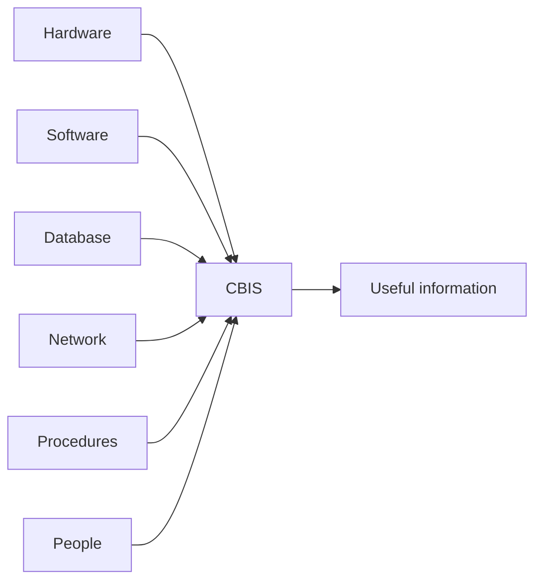
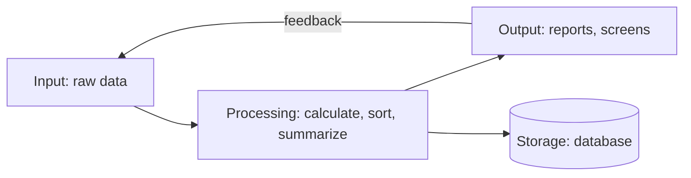

**In one line:** <mark>A CBIS is an information system that uses computer technology (hardware, software, database, network) with procedures and people to turn data into useful information</mark>. <Cite id="is-fundamentals-wiley-rainer" />

<Box kind="key">

**Key points to write (any CBIS question):**

- <mark>CBIS = information system that uses computers to collect, process, store and share information</mark>.
- <mark>Six components: hardware, software, database, network, procedures, people</mark>.
- Four are **technology** parts; **procedures and people** make it a working system.
- Some books list **five** (no procedures); writing all six is safe.
- <mark>Advantages: speed, accuracy, large storage, instant sharing</mark>; limits: cost, garbage in garbage out, security.
- Types of CBIS follow the pyramid: <mark>TPS, OAS/KWS, MIS, DSS, ESS, expert system</mark>.

</Box>

## Core answer (5 marks, fits every question here)

<Box kind="definition">

A **computer-based information system (CBIS)** is an information system that uses computers to collect, store, process and share information. It has six parts, and it works only when all six are present, like a car that needs a body, engine, fuel, roads, rules and a driver. <Cite id="is-fundamentals-wiley-rainer" />

</Box>

**Why computers:** a manual system is slow, error-prone and hard to search. A computer handles thousands of transactions a second and finds any record instantly.

| Component | Meaning | Example (airline booking) |
|---|---|---|
| Hardware | Physical devices | Counter computers, printers |
| Software | System and application programs | Booking program, OS |
| Database | Organized data store | Flights, seats, fares |
| Network | Wired or wireless links | Airport and agent network |
| Procedures | Rules for use | Check-in and cancellation steps |
| People | Users, operators, analysts | Counter staff, IT staff |

<Cite id="is-fundamentals-gfg-components" />

**Conclusion:** <mark>hardware, software, database and network are the technology parts; procedures and people make them a working system</mark>. <Cite id="is-fundamentals-wiki-is" />

## Extended answer (10 marks): add these

### 1. Types of CBIS (by level)

| Type | Level | Example |
|---|---|---|
| TPS | Operational | SBI deposits and withdrawals |
| OAS and KWS | Knowledge | Email, CAD |
| MIS | Middle management | Monthly sales report |
| DSS | Middle and upper | What-if analysis of free delivery offers |
| ESS | Top management | CEO dashboard |
| Expert system | Any level | Medical diagnosis advice |

<Cite id="is-fundamentals-gfg-types" />

### 2. Manual system versus CBIS

| Point | Manual IS | CBIS |
|---|---|---|
| Speed | Slow | Very fast |
| Errors | Copying errors | Few, with validation |
| Storage | Paper, bulky | Small space, huge data |
| Search | Hard | Instant |
| Sharing | By hand | Over a network |

### 3. Advantages, limitations and applications

- **Advantages:** speed, accuracy, large storage, instant sharing, better decisions, automation of routine work.
- **Limitations:** high cost, "garbage in, garbage out", security risks, dependence on power and network, staff resistance.
- **Applications:** banking (ATMs), railway and airline reservation, hospital management, college results, supermarket billing.

## Fit it to each question

- **"Explain in detail computer-based information systems."** (10 marks) <PYQ id="2023-05-ce/q6a" />: definition, six-component diagram and table, types of CBIS, manual versus CBIS, advantages, limitations, applications.
- **"List the various components of CBIS."** (5 marks) <PYQ id="2024-05-ce/q1a" />: core answer only; list all six with one-line meaning and an example, plus the diagram.

## Exam tips

- **Always write all six** components, and say "some books list five".
- Use **one running example** (airline or bank) for every component.
- For the 10-marker, do not stop at components; add types, advantages and limitations.
