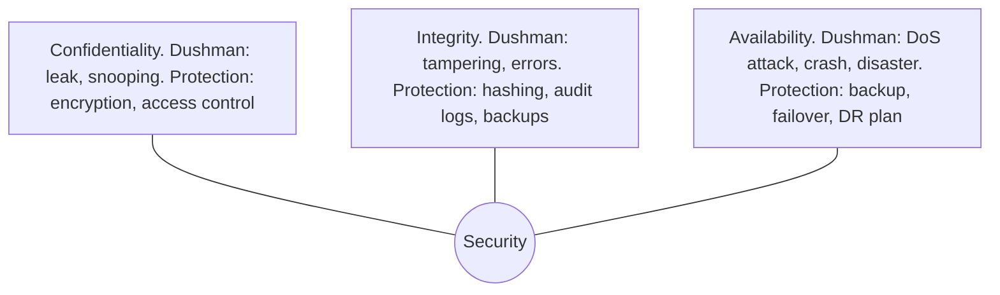
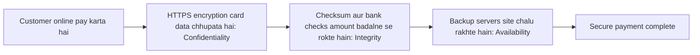

**Ek line mein:** <mark>CIA (Confidentiality, Integrity, Availability) information security ke teen basic goals hain</mark>. Har attack inmein se ek ya zyada pe hit karta hai, aur har control inmein se ek ya zyada ko protect karta hai. <Cite id="note-information-security-gfg-cia" />

<Box kind="key">

**Har CIA question mein ye points likho:**

- <mark>Confidentiality: sirf authorized log information dekh sakein</mark>. Protection: encryption, passwords, access control.
- <mark>Integrity: information complete, accurate ho aur sirf authorized log badal sakein</mark>. Protection: hashing, digital signatures, audit logs, backups.
- <mark>Availability: authorized users ko jab chahiye tab information aur systems mile</mark>. Protection: backups, redundant servers, DDoS protection, disaster recovery.
- Har ek ka ek **failure example** (data leak, badla hua balance, sale ke din DDoS).
- Kuch books mein extra goals: **authenticity** aur **non-repudiation**.
- <mark>Security ek trade-off hai</mark>: bahut zyada confidentiality availability kam kar sakti hai.

</Box>

## Core answer (5 marks, yahan ke har question ke liye)

<Box kind="definition">

The **CIA triad** is the model of the three goals of information security: **Confidentiality** (only the right people see it), **Integrity** (it stays correct) and **Availability** (it can be used when needed). <Cite id="note-information-security-gfg-cia" /> <Cite id="web-mis-2-nist-glossary-infosec" />

</Box>

| Goal | Matlab | Failure example | Typical controls |
|---|---|---|---|
| Confidentiality | Sirf authorized log dekhein | Hacker card numbers padh leta hai | Encryption, authentication, VPN |
| Integrity | Complete, accurate, sirf authorized change | Koi bank balance badal deta hai | Hash checks, digital signatures, audit logs |
| Availability | Jab chahiye tab usable | Sale ke din DDoS se shopping site down | Backups, redundant servers, disaster recovery |

<Cite id="note-information-security-gfg-cia" /> <Cite id="note-information-security-tp-ism" />

**Security achieve karne mein role:** teen goals organization ko batate hain ki **kya aur kis se bachana hai**. Har control kam se kam ek corner ko defend karne ke liye chuna jaata hai, aur system tabhi secure hai jab teeno hold karein. <Cite id="web-mis-2-nist-sp800-12" />

**Conclusion:** <mark>CIA har security policy ki foundation hai</mark>: pehle decide karo kaunsa goal sabse zaroori hai, phir uske controls chuno.

## Extended answer (10 marks): ye add karo

### 1. Har goal detail mein

- **Confidentiality** galat logon ko disclosure rokti hai. Methods: encryption (public-key: receiver ki public key se lock, private key se unlock), strong passwords, multi-factor authentication, **least privilege** (kaam ke hisaab se hi access). <Cite id="note-information-security-wiki-pubkey" />
- **Integrity** unauthorized ya accidental change rokti hai. Methods: hash checks, digital signatures, version control, input validation, audit trails.
- **Availability** service chalti rakhti hai. Methods: backups, spare servers (failover), UPS aur generator, DDoS protection, disaster recovery plan. Denial-of-service attack server ko traffic se bhar deta hai, isliye asli users andar nahi aa paate. <Cite id="note-information-security-wiki-dos" />

### 2. Teeno saath kaise kaam karte hain

### 3. Do extra goals

**Authenticity** (user ya message sach mein wahi hai jo wo kehta hai) aur **non-repudiation** (koi baad mein apna action deny nahi kar sakta, jaise signed payment). <Cite id="note-information-security-tp-ism" />

### 4. Balance aur evaluation

| Point | Evaluation |
|---|---|
| Trade-off | Safe mein band bina network ka system bahut confidential hai lekin available nahi |
| Priority alag | Bank: integrity pehle. Hospital emergency: availability pehle. Military: confidentiality pehle |
| Cost | Zyada protection zyada paisa leti hai aur users ko slow karti hai |
| Limit | CIA sirf information ke baare mein hai; log, law aur process bhi matter karte hain |

**Conclusion:** <mark>CIA batata hai security ko kya achieve karna hai; controls batate hain kaise</mark>. Har goal ko business ke hisaab se evaluate karo aur balance chuno.

## Har question mein kaise fit karein

- **"Evaluate the role of Confidentiality, Integrity and Availability in order to achieve security."** (10 marks) <PYQ id="2022-12-ce/q4b" />: core answer (triangle, table) plus section 1 (methods), section 2 (ek payment mein teeno) aur section 4 (trade-off aur priority). "Evaluate" matlab judgement do: kis business mein kaunsa goal sabse zaroori hai.

## Exam tips

- **CIA triangle draw karo** aur har corner ka failure example aur controls do.
- "Evaluate" ya "role" mein hamesha end mein **trade-off** aur judgement likho, sirf definitions nahi.
- Integrity (sahi data) ko confidentiality (secret data) se mat milao.

Exam mein English mein likho.
