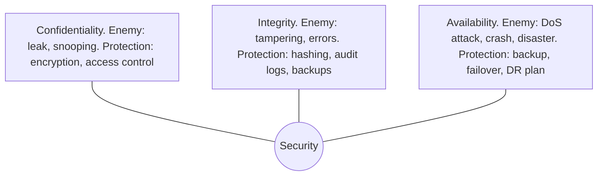
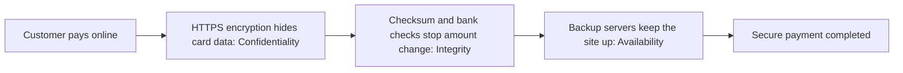

**In one line:** <mark>CIA (Confidentiality, Integrity, Availability) are the three basic goals of information security</mark>. Every attack hits one or more of them, and every control protects one or more of them. <Cite id="note-information-security-gfg-cia" />

<Box kind="key">

**Key points to write (any CIA question):**

- <mark>Confidentiality: only authorized people can see the information</mark>. Protect with encryption, passwords, access control.
- <mark>Integrity: information is complete, accurate and changed only by authorized people</mark>. Protect with hashing, digital signatures, audit logs, backups.
- <mark>Availability: authorized users can reach information and systems when needed</mark>. Protect with backups, redundant servers, DDoS protection, disaster recovery.
- One **failure example** for each (data leak, altered balance, DDoS on sale day).
- Extra goals in some books: **authenticity** and **non-repudiation**.
- <mark>Security is a trade-off</mark>: too much confidentiality can reduce availability.

</Box>

## Core answer (5 marks, fits every question here)

<Box kind="definition">

The **CIA triad** is the model of the three goals of information security: **Confidentiality** (only the right people see it), **Integrity** (it stays correct) and **Availability** (it can be used when needed). <Cite id="note-information-security-gfg-cia" /> <Cite id="web-mis-2-nist-glossary-infosec" />

</Box>

| Goal | Meaning | Example of failure | Typical controls |
|---|---|---|---|
| Confidentiality | Only authorized people see it | Hacker reads card numbers | Encryption, authentication, VPN |
| Integrity | Complete, accurate, changed only by authorized people | Someone alters a bank balance | Hash checks, digital signatures, audit logs |
| Availability | Usable when needed | DDoS takes a shopping site down on sale day | Backups, redundant servers, disaster recovery |

<Cite id="note-information-security-gfg-cia" /> <Cite id="note-information-security-tp-ism" />

**Role in achieving security:** the three goals tell the organization **what to protect and from what**. Every control is chosen to defend at least one corner, and a system is secure only when all three hold. <Cite id="web-mis-2-nist-sp800-12" />

**Conclusion:** <mark>CIA is the foundation of every security policy</mark>: first decide which goal matters most, then choose controls for it.

## Extended answer (10 marks): add these

### 1. Each goal in detail

- **Confidentiality** stops disclosure to the wrong people. Methods: encryption (public-key: lock with the receiver's public key, unlock with the private key), strong passwords, multi-factor authentication, **least privilege** (give only the access the work needs). <Cite id="note-information-security-wiki-pubkey" />
- **Integrity** stops unauthorized or accidental change. Methods: hash checks, digital signatures, version control, input validation, audit trails.
- **Availability** keeps the service running. Methods: backups, spare servers (failover), UPS and generators, DDoS protection, a disaster recovery plan. A denial-of-service attack floods a server with traffic so real users cannot get in. <Cite id="note-information-security-wiki-dos" />

### 2. How the three work together

### 3. Two extra goals

**Authenticity** (the user or message is really who it claims) and **non-repudiation** (a person cannot later deny an action, for example a signed payment). <Cite id="note-information-security-tp-ism" />

### 4. Balance and evaluation

| Point | Evaluation |
|---|---|
| Trade-off | A system in a locked safe with no network is very confidential but not available |
| Priority differs | Bank: integrity first. Hospital emergency: availability first. Military: confidentiality first |
| Cost | More protection costs more money and slows users |
| Limit | CIA is about information only; people, law and process also matter |

**Conclusion:** <mark>CIA tells us what security must achieve; controls tell us how</mark>. Evaluate each goal against the business and choose a balance.

## Fit it to each question

- **"Evaluate the role of Confidentiality, Integrity and Availability in order to achieve security."** (10 marks) <PYQ id="2022-12-ce/q4b" />: core answer (triangle, table) plus section 1 (methods), section 2 (one payment using all three) and section 4 (trade-off and priority). "Evaluate" means give a judgement: say which goal matters most in which business.

## Exam tips

- **Draw the CIA triangle** and give a failure example plus controls for each corner.
- For "evaluate" or "role", always end with the **trade-off** and a judgement, not only definitions.
- Do not confuse integrity (correct data) with confidentiality (secret data).
