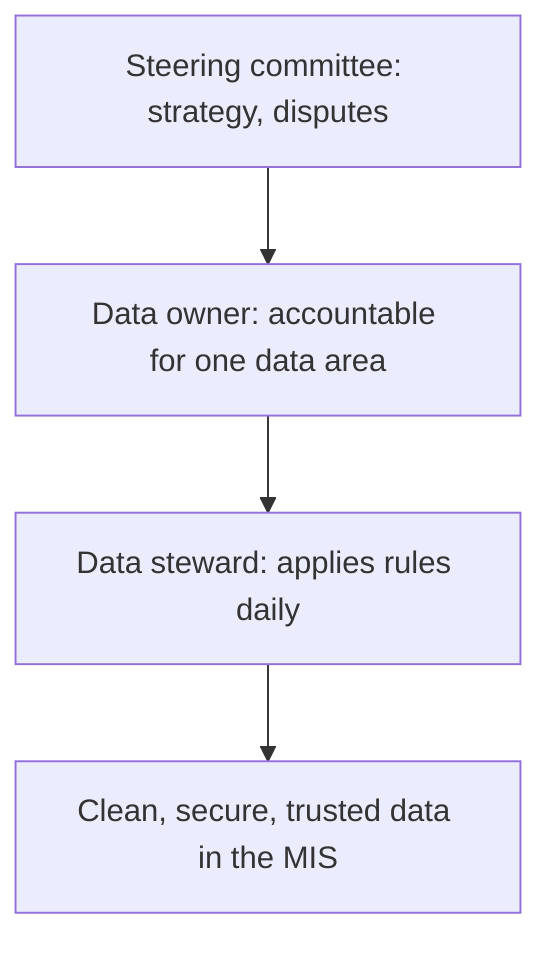
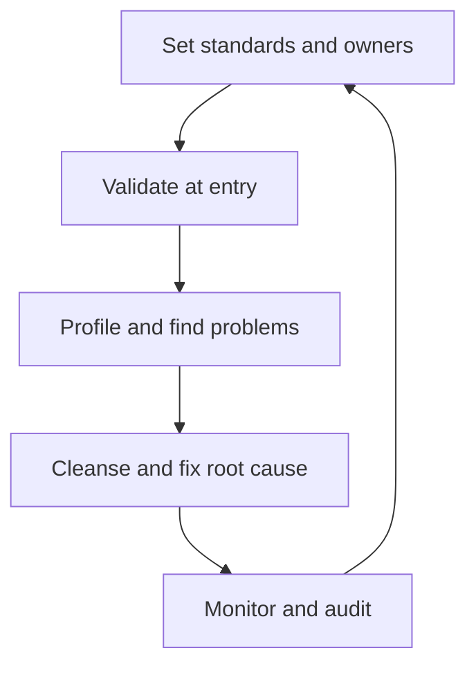

**Ek line mein:** <mark>Data governance organization ke data ke rules, owners aur processes set karta hai, aur data quality ka matlab hai data apne kaam ke liye accurate, complete aur consistent hai</mark>. <Cite id="data-management-ibm-data-governance" />

<Box kind="key">

**Ye points likho:**

- <mark>Data governance = policies, standards, roles aur processes jo decide karte hain data kaise create, store, use, protect aur retire ho</mark>.
- <mark>Roles: steering committee, data owner, data steward</mark>.
- <mark>Quality dimensions: accuracy, completeness, consistency, timeliness, validity, uniqueness</mark>.
- <mark>Master data management (MDM) har customer ya product ka ek trusted "golden record" rakhta hai</mark>.
- <mark>Quality ek cycle hai: standards, entry pe validate, profile, cleanse, monitor</mark>.
- Kharab data se kharab decisions: **garbage in, garbage out**.

</Box>

## Core answer (5 marks, yahan ke har question ke liye)

<Box kind="definition">

**Data governance** is the set of policies, standards, roles and processes that decide how data is created, stored, used, protected and retired across the whole organization. **Data quality** means the data is fit for the job it is used for. <Cite id="data-management-wiki-data-governance" /> <Cite id="data-management-ibm-data-quality" />

</Box>

Governance shehar ke traffic rules jaisa hai: sirf roads kaafi nahi.

**MIS mein governance kaise hota hai, step by step**

1. **Goals set karo:** jaise "billing errors kam" ya "privacy audit pass".
2. **Roles do:** steering committee, data owner, data steward.
3. **Policies aur standards likho:** common definitions, format rules, access rules, data kitne time rakhna hai.
4. **Data catalog banao:** kaun sa data hai aur uska matlab kya hai, ek list.
5. **Master data aur quality manage karo:** ek golden record, regular cleaning. <Cite id="data-management-gfg-mdm" />
6. **Access aur security control karo:** har role ko sirf zaroori data dikhe.
7. **Lineage track karo aur audit karo:** data kahan se aaya aur rules follow hue ya nahi.

**Conclusion:** <mark>governance MIS ko one version of the truth, better decisions aur leaks ka kam risk deta hai</mark>. Example: SBI ek customer record rakhta hai jo har branch aur app use karti hai.

## Extended answer (10 marks): ye add karo

### 1. Data quality ke dimensions <Cite id="data-management-wiki-data-quality" />

| Dimension | Kya poochta hai | Bad example |
|---|---|---|
| Accuracy | Value sahi hai? | Galat date of birth |
| Completeness | Kuch missing hai? | Customer ka phone number nahi |
| Consistency | Systems match karte hain? | Sales aur billing mein alag address |
| Timeliness | Up to date hai? | Pichhle mahine ke stock levels |
| Validity | Format rules follow? | 5 digit ka PIN code |
| Uniqueness | Ek hi baar record? | Same customer do baar |

### 2. Quality kaise ensure hoti hai

1. **Standards set karo (governance):** har field, uske rules aur owner define karo.
2. **Entry pe validate:** drop-down lists, format checks, mandatory fields, sabse sasti jagah pe errors rokte hain.
3. **Data profile karo:** tables scan karke missing values, duplicates, ajeeb values dhoondho.
4. **Cleanse:** errors theek, gaps bharo, duplicates hatao.
5. **MDM use karo:** har customer ya product ka ek trusted record. <Cite id="data-management-ibm-mdm" />
6. **Root cause dhoondho:** process theek karo (kharab form, untrained clerk), sirf record nahi.
7. **Lagatar monitor karo:** quality dashboards aur audits, kyunki data purana hota hai.

**Example:** Flipkart entry pe check karta hai ki PIN code 6 digit ka ho, duplicate customers merge karta hai aur galat address se failed deliveries track karta hai.

### 3. Governance vs quality

| Governance | Quality |
|---|---|
| Rules, roles, policies | Data rules pe khara utra ya nahi |
| Decide karta hai kaun owner aur kaun use kare | Data napta aur theek karta hai |

## Har question mein kaise fit karein

- **"How is data governance achieved in case of MIS?"** (5 marks) <PYQ id="2022-12-ce/q1b" />: core answer: definition, saat steps, diagram mein roles, SBI example.
- **"How the quality of data is ensured in an organization?"** (10 marks) <PYQ id="2024-05-ce/q6b" />: garbage in garbage out ek line, section 1 table, section 2 steps aur cycle diagram, Flipkart example, governance se link ek line.

## Exam tips

- **Cycle** (quality) ya **owner-steward chain** (governance) draw karo.
- Chhe quality words **ek bad example** ke saath yaad karo.
- "**Validate at entry**" aur "**master data**" likho; examiner yahi keywords dhoondhte hain.

Exam mein English mein likho.
