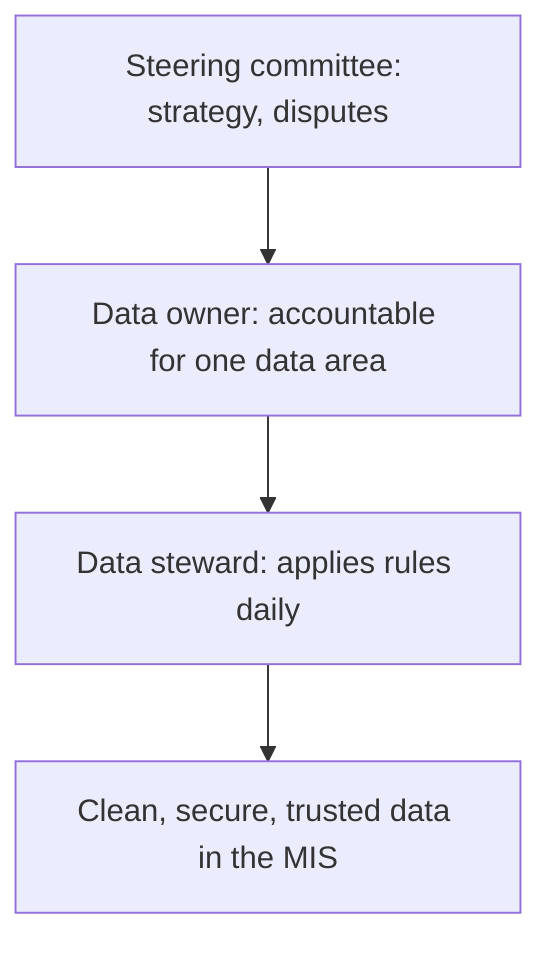
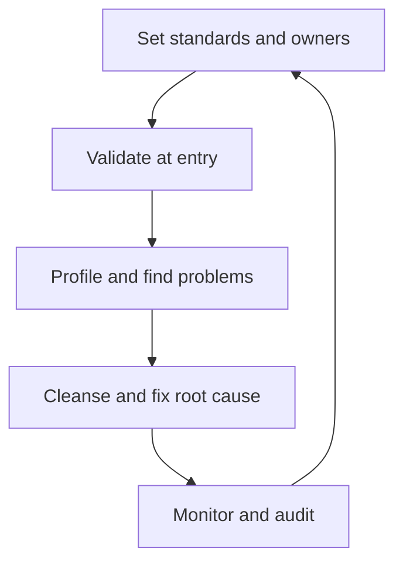

**In one line:** <mark>Data governance sets the rules, owners and processes for an organization's data, and data quality means the data is accurate, complete and consistent enough for the job it is used for</mark>. <Cite id="data-management-ibm-data-governance" />

<Box kind="key">

**Key points to write:**

- <mark>Data governance = policies, standards, roles and processes that decide how data is created, stored, used, protected and retired</mark>.
- <mark>Roles: steering committee, data owner, data steward</mark>.
- <mark>Quality dimensions: accuracy, completeness, consistency, timeliness, validity, uniqueness</mark>.
- <mark>Master data management (MDM) keeps one trusted "golden record" per customer or product</mark>.
- <mark>Quality is a cycle: standards, validate at entry, profile, cleanse, monitor</mark>.
- Bad data gives bad decisions: **garbage in, garbage out**.

</Box>

## Core answer (5 marks, fits every question here)

<Box kind="definition">

**Data governance** is the set of policies, standards, roles and processes that decide how data is created, stored, used, protected and retired across the whole organization. **Data quality** means the data is fit for the job it is used for. <Cite id="data-management-wiki-data-governance" /> <Cite id="data-management-ibm-data-quality" />

</Box>

Governance is like traffic rules for a city: roads alone are not enough.

**How governance is achieved in an MIS, step by step**

1. **Set goals:** for example "fewer billing errors" or "pass the privacy audit".
2. **Assign roles:** steering committee, data owner, data steward.
3. **Write policies and standards:** common definitions, format rules, access rules, how long to keep data.
4. **Build a data catalog:** one list of what data exists and what it means.
5. **Manage master data and quality:** keep one golden record, clean regularly. <Cite id="data-management-gfg-mdm" />
6. **Control access and security:** each role sees only the data it needs.
7. **Track lineage and audit:** record where data came from and check the rules are followed.

**Conclusion:** <mark>governance gives the MIS one version of the truth, better decisions and lower risk of leaks</mark>. Example: SBI keeps one customer record that every branch and app uses.

## Extended answer (10 marks): add these

### 1. Dimensions of data quality <Cite id="data-management-wiki-data-quality" />

| Dimension | Question it asks | Bad example |
|---|---|---|
| Accuracy | Is the value correct? | Wrong date of birth |
| Completeness | Is anything missing? | Customer with no phone number |
| Consistency | Do systems agree? | Different addresses in sales and billing |
| Timeliness | Is it up to date? | Last month's stock levels |
| Validity | Does it follow format rules? | PIN code with 5 digits |
| Uniqueness | Recorded once? | Same customer entered twice |

### 2. How quality is ensured

1. **Set standards (governance):** define each field, its rules and its owner.
2. **Validate at entry:** drop-down lists, format checks, mandatory fields stop errors at the cheapest place.
3. **Profile the data:** scan tables for missing values, duplicates, odd values.
4. **Cleanse:** correct errors, fill gaps, remove duplicates.
5. **Use MDM:** one trusted record per customer or product. <Cite id="data-management-ibm-mdm" />
6. **Find root causes:** fix the process (bad form, untrained clerk), not only the record.
7. **Monitor continuously:** quality dashboards and audits, because data decays.

**Example:** Flipkart checks that a PIN code has six digits at entry, merges duplicate customers and tracks failed deliveries caused by wrong addresses.

### 3. Governance versus quality

| Governance | Quality |
|---|---|
| Rules, roles, policies | Whether the data meets the rules |
| Decides who owns and may use data | Measures and fixes the data |

## Fit it to each question

- **"How is data governance achieved in case of MIS?"** (5 marks) <PYQ id="2022-12-ce/q1b" />: core answer: definition, the seven steps, roles in the diagram, SBI example.
- **"How the quality of data is ensured in an organization?"** (10 marks) <PYQ id="2024-05-ce/q6b" />: one line on garbage in garbage out, section 1 table, section 2 steps and cycle diagram, Flipkart example, one line linking to governance.

## Exam tips

- **Draw** the cycle (quality) or the owner-steward chain (governance).
- Learn the six quality words with **one bad example** each.
- Say "**validate at entry**" and "**master data**"; they are the keywords examiners look for.
