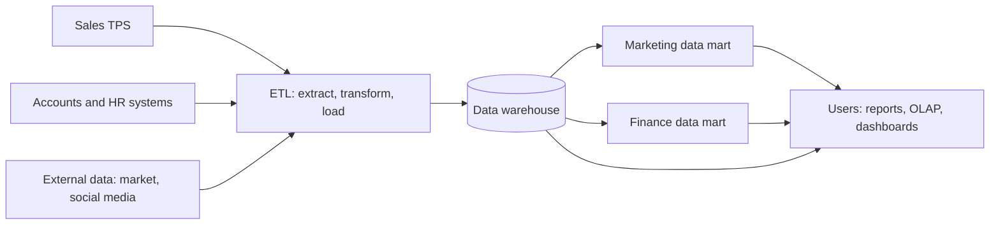

**Ek line mein:** <mark>Data warehouse bahut saare sources ke current aur historical data ka central store hai, analysis ke liye organised; data mart uska ek chhota slice hai, ek department ke liye</mark>. <Cite id="data-management-tp-dwh-overview" />

<Box kind="key">

**Warehouse / mart ke har question mein ye points likho:**

- <mark>Data warehouse = subject-oriented, integrated, time-variant aur non-volatile data collection</mark> (Bill Inmon).
- <mark>Kyun: heavy analysis live billing systems ko slow karta hai, aur data kai formats mein bikhra hai</mark>.
- <mark>Flow: source systems, ETL (extract, transform, load), warehouse, data marts, users</mark>.
- <mark>Data mart = ek subject ya department ka chhota warehouse</mark>: dependent, independent, hybrid.
- Warehouse **bada, slow aur costly**; mart **chhota, quick aur sasta**.
- Big data examples: **retail transactions** (Walmart) aur **social media** (Facebook).

</Box>

## Core answer (5 marks, yahan ke har question ke liye)

<Box kind="definition">

A **data warehouse** is a central store of current and historical data gathered from many sources, organized for analysis and decision making. A **data mart** is a small data warehouse focused on one subject or department, such as marketing or finance. <Cite id="data-management-tp-dwh-overview" /> <Cite id="data-management-ibm-data-mart" />

</Box>

Hotel chain ki central kitchen (warehouse) aur har restaurant ka counter (data mart) socho. <Cite id="data-management-gfg-dw-vs-dm" />

**Kyun chahiye:** live billing database pe heavy analysis chalane se real customers slow ho jaate hain, aur data kai systems mein alag formats mein hota hai. Warehouse use ek jagah copy karta hai jo analysis ke liye bani hai.

| Point | Data warehouse | Data mart |
|---|---|---|
| Scope | Poori organization | Ek department |
| Size | Bada | Chhota |
| Sources | Bahut | Kam, ya warehouse |
| Time aur cost | Zyada | Kam |
| Users | Kai groups | Ek group |

<Cite id="data-management-gfg-data-warehousing" />

**Conclusion:** <mark>warehouse company-wide view deta hai, marts har team ko fast aur focused view dete hain</mark>.

## Extended answer (10 marks): ye add karo

### 1. Warehouse ki chaar properties

- **Subject-oriented:** customer, product ya sales ke hisaab se organized, program ke hisaab se nahi.
- **Integrated:** alag sources ka data ek format aur ek code set mein.
- **Time-variant:** saalon ki history, taaki trends dikhein.
- **Non-volatile:** load hota hai aur padha jaata hai, daily kaam se badla nahi jaata. <Cite id="data-management-wiki-data-warehouse" />

### 2. Ye kaise kaam karta hai (ETL)

1. **Extract:** operational systems aur bahar ke sources se data nikalo.
2. **Transform:** errors clean karo, duplicates hatao, common formats use karo.
3. **Load:** warehouse mein metadata (data ke baare mein data) ke saath.
4. **Use:** reports, OLAP, data mining, ya data mart. <Cite id="data-management-ibm-etl" />

### 3. Data mart ke types aur operational database vs warehouse

- **Dependent** (warehouse se bana), **independent** (sources se seedha), **hybrid**.

| Operational database | Data warehouse |
|---|---|
| Daily transactions | Analysis aur reports |
| Current data | Current aur historical data |
| Hamesha badalta hai | Mostly read only |
| Bahut chhote updates | Kam bade queries |

### 4. Organization mein use, advantages aur disadvantages

- **Use:** Walmart aur Flipkart har store ya city ki festival-wise sales dekhte hain; bank customer history se loan offers banata hai.
- **Advantages:** ek consistent view, trends ke liye history, daily kaam slow kiye bina fast analysis.
- **Disadvantages:** banane mein costly aur slow, cleaning mushkil, aur bahut independent marts "data islands" bana dete hain jinke numbers match nahi karte.

### 5. Big Data generate karne wale do examples <Cite id="data-management-wiki-big-data" />

1. **Retail transactions:** Wikipedia ke hisaab se Walmart ghante mein 1 million se zyada customer transactions handle karta hai. Har bill, item aur payment data badhata hai.
2. **Social media:** Facebook ya Instagram pe har like, share, comment aur photo store hota hai. E-commerce clicks se bhi aisa data aata hai.

Ye **volume, velocity aur variety** dikhate hain.

## Har question mein kaise fit karein

- **"What is Data Mart and Data Warehouses? Give two examples which show generation of Big Data."** (10 marks) <PYQ id="2022-12-ce/q3b" /> <PYQ id="2023-05-ce/q6b" />: core answer, comparison table, phir section 5 (do big data examples) zaroor likho.
- **"Explain Data warehouse and Data Mart in an organization."** (10 marks) <PYQ id="2023-12-ce/q2b" />: core answer, sections 1 aur 3, table, section 4 (organization mein use), advantages aur disadvantages.
- **"Explain Data warehouse in an organization."** (10 marks) <PYQ id="2024-12-ce/q2b" />: definition, chaar properties, ETL steps aur diagram, operational vs warehouse table, use, advantages aur disadvantages; marts ek line mein.

## Exam tips

- **ETL flow diagram marts ke saath draw karo**; sabse zyada marks isi figure ke.
- Inmon ke chaar words likho: **subject-oriented, integrated, time-variant, non-volatile**.
- "In an organization" ke liye **real use** (Walmart, bank) do, sirf definitions nahi.

Exam mein English mein likho.
