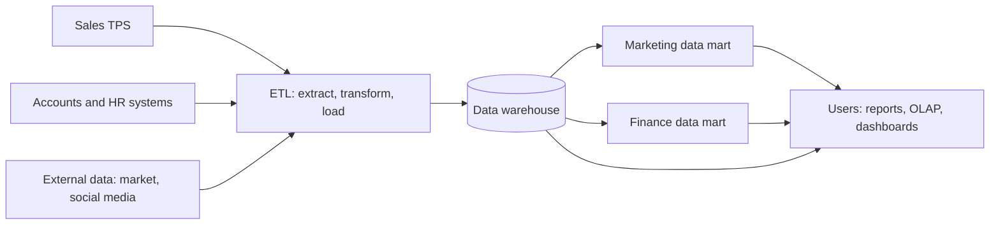

**In one line:** <mark>A data warehouse is a central store of current and historical data from many sources, organised for analysis; a data mart is a small slice of it for one department</mark>. <Cite id="data-management-tp-dwh-overview" />

<Box kind="key">

**Key points to write (any warehouse / mart question):**

- <mark>Data warehouse = subject-oriented, integrated, time-variant and non-volatile collection of data</mark> (Bill Inmon).
- <mark>Why: heavy analysis slows live billing systems, and data sits in many formats</mark>.
- <mark>Flow: source systems, ETL (extract, transform, load), warehouse, data marts, users</mark>.
- <mark>Data mart = small warehouse for one subject or department</mark>: dependent, independent, hybrid.
- Warehouse is **big, slow and costly**; a mart is **small, quick and cheap**.
- Big data examples: **retail transactions** (Walmart) and **social media** (Facebook).

</Box>

## Core answer (5 marks, fits every question here)

<Box kind="definition">

A **data warehouse** is a central store of current and historical data gathered from many sources, organized for analysis and decision making. A **data mart** is a small data warehouse focused on one subject or department, such as marketing or finance. <Cite id="data-management-tp-dwh-overview" /> <Cite id="data-management-ibm-data-mart" />

</Box>

Think of a hotel chain's central kitchen (warehouse) and each restaurant's counter (data mart). <Cite id="data-management-gfg-dw-vs-dm" />

**Why needed:** running heavy analysis on live billing databases slows real customers down, and the data is spread across many systems in different formats. A warehouse copies it into one place built for analysis.

| Point | Data warehouse | Data mart |
|---|---|---|
| Scope | Whole organization | One department |
| Size | Large | Smaller |
| Sources | Many | Few, or the warehouse |
| Time and cost | Long and high | Short and low |
| Users | Many groups | One group |

<Cite id="data-management-gfg-data-warehousing" />

**Conclusion:** <mark>the warehouse gives a company-wide view, marts give each team a fast and focused view</mark>.

## Extended answer (10 marks): add these

### 1. The four properties of a warehouse

- **Subject-oriented:** organized by customer, product or sales, not by program.
- **Integrated:** data from different sources in one format and one set of codes.
- **Time-variant:** keeps years of history so trends can be seen.
- **Non-volatile:** loaded and read, not changed by daily work. <Cite id="data-management-wiki-data-warehouse" />

### 2. How it works (ETL)

1. **Extract** data from operational systems and outside sources.
2. **Transform:** clean errors, remove duplicates, use common formats.
3. **Load** into the warehouse with metadata (data about the data).
4. **Use:** reports, OLAP and data mining, or take a data mart. <Cite id="data-management-ibm-etl" />

### 3. Types of data mart and operational database versus warehouse

- **Dependent** (built from the warehouse), **independent** (built directly from sources), **hybrid**.

| Operational database | Data warehouse |
|---|---|
| Daily transactions | Analysis and reports |
| Current data | Current and historical data |
| Changes all the time | Mostly read only |
| Many small updates | Few big queries |

### 4. Use in an organization, advantages and disadvantages

- **Use:** Walmart and Flipkart study sales per store or city per festival; a bank designs loan offers from customer history.
- **Advantages:** one consistent view, history for trends, fast analysis without slowing daily work.
- **Disadvantages:** costly and slow to build, cleaning is hard, and many independent marts create "data islands" with conflicting numbers.

### 5. Two examples that generate Big Data <Cite id="data-management-wiki-big-data" />

1. **Retail transactions:** Walmart handles more than 1 million customer transactions an hour, according to Wikipedia. Every bill, item and payment adds data.
2. **Social media:** every like, share, comment and photo on Facebook or Instagram is stored. Similar data comes from e-commerce clicks.

These show **volume, velocity and variety**.

## Fit it to each question

- **"What is Data Mart and Data Warehouses? Give two examples which show generation of Big Data."** (10 marks) <PYQ id="2022-12-ce/q3b" /> <PYQ id="2023-05-ce/q6b" />: core answer, comparison table, then section 5 (the two big data examples) as a required part.
- **"Explain Data warehouse and Data Mart in an organization."** (10 marks) <PYQ id="2023-12-ce/q2b" />: core answer, sections 1 and 3, table, section 4 (use in an organization), advantages and disadvantages.
- **"Explain Data warehouse in an organization."** (10 marks) <PYQ id="2024-12-ce/q2b" />: definition, four properties, ETL steps and diagram, operational versus warehouse table, use, advantages and disadvantages; mention marts in one line only.

## Exam tips

- **Draw** the ETL flow diagram with marts; it is the most rewarded figure.
- Write the four Inmon words: **subject-oriented, integrated, time-variant, non-volatile**.
- For "in an organization", give a **real use** (Walmart, bank), not only definitions.
