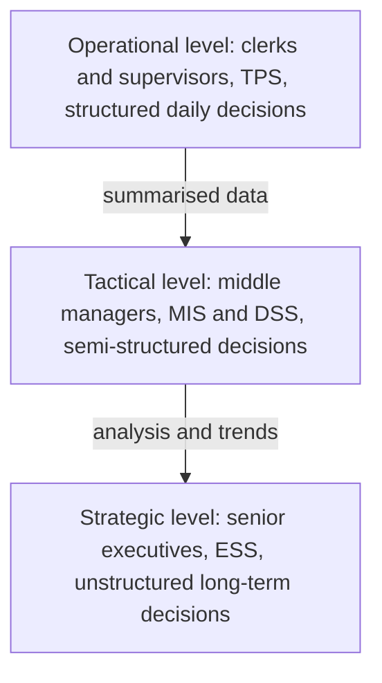
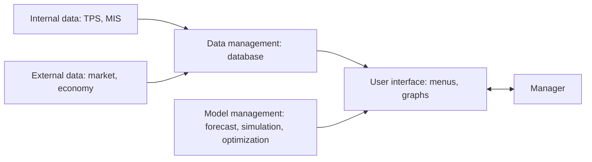

**Ek line mein:** <mark>DSS ek interactive computer system hai jo data, models aur easy interface milakar managers ko semi-structured aur unstructured decisions mein help karta hai; ye manager ko support karta hai, unki jagah decide nahi karta</mark>. <Cite id="business-intelligence-wiki-dss" />

<Box kind="key">

**Har DSS question mein ye points likho:**

- <mark>DSS = data + models + user interface wala interactive system, semi-structured problems ke liye</mark>.
- <mark>Teen components: data management, model management, user interface</mark>.
- <mark>MIS hierarchy: operational (TPS), tactical (MIS aur DSS), strategic (ESS)</mark>.
- <mark>DSS "what if" ka jawab deta hai; MIS fixed regular reports deta hai</mark>.
- Analyses: **what-if, sensitivity, goal seeking**.
- Applications: healthcare, banking, agriculture, manufacturing, marketing, transport.

</Box>

## Core answer (5 marks, yahan ke har question ke liye)

<Box kind="definition">

A **Decision Support System (DSS)** is an interactive, computer-based system that combines data, models and an easy interface to help managers solve semi-structured and unstructured problems. It supports the decision; the manager still makes it. <Cite id="business-intelligence-wiki-dss" />

</Box>

Ye manager ke liye GPS app jaisa hai: options aur effects dikhata hai, lekin gaadi manager chalata hai. <Cite id="business-intelligence-tp-dss" />

**Kahan fit hota hai (MIS hierarchy):** business mein managers ke teen levels hote hain, aur har level ko alag system chahiye. Level jitna upar, decisions utne kam structured. <Cite id="is-fundamentals-gfg-types" />

**Components:** (1) data management: internal aur external data, (2) model management: forecasting, simulation, optimization, (3) user interface: menus aur graphs. <Cite id="is-fundamentals-tp-dss" />

**Conclusion:** <mark>hierarchy system ko manager se match karti hai, aur DSS middle level pe data ko choices mein badalne wala tool hai</mark>.

## Extended answer (10 marks): ye add karo

### 1. DSS ka architecture

### 2. DSS kaun se analyses deta hai

- **What-if analysis:** "price 5 percent badha dein to kya hoga?"
- **Sensitivity analysis:** kaun sa input result ko sabse zyada badalta hai. <Cite id="business-intelligence-wiki-sensitivity" />
- **Goal seeking:** "10 lakh profit ke liye kitne units bechne honge?"

### 3. DSS ke applications

| Field | DSS ka use |
|---|---|
| Healthcare | Diagnosis aur treatment ke liye clinical decision support |
| Banking | Credit check, loan approval, branch performance |
| Agriculture | Soil aur weather data se crops aur inputs ki planning |
| Manufacturing aur logistics | Production schedule, inventory levels, route planning |
| Marketing aur finance | Pricing, budgeting, sales forecasting, investment choice |
| Transport | Airlines aur railways crew aur equipment schedule karte hain |

<Cite id="is-fundamentals-gfg-dss" />

### 4. MIS vs DSS

| Point | MIS | DSS |
|---|---|---|
| Output | Fixed, regular reports | Naye questions ke jawab |
| Problem | Structured | Semi-structured, unstructured |
| User ka role | Report padhta hai | Interact karke options try karta hai |
| Focus | Past aur present | Future ke effects |

<Cite id="is-fundamentals-gfg-mis-vs-dss" />

### 5. Advantages aur limits

**Advantages:** fast, better-informed decisions; kai options safely try hote hain. **Limits:** banana costly; result data aur model jitna hi achha; managers model pe zyada bharosa kar sakte hain.

## Har question mein kaise fit karein

- **"Evaluate the MIS Hierarchy to comment on Decision Support System."** (5 marks) <PYQ id="2022-12-ce/q1d" />: core answer; pehle hierarchy diagram pe zor, phir DSS pe comment: strengths, limits aur section 4 ka MIS se comparison. Example: Amazon pricing team "price 5 percent kam karein to?" test karti hai.
- **"What is Decision Support System. Explain the application of DSS."** (10 marks) <PYQ id="2025-05-ce/q6a" />: definition, architecture diagram, analyses, phir **applications table** main part, advantages aur limits.

## Exam tips

- Question 1 ke liye **hierarchy** aur question 2 ke liye **architecture** draw karo.
- Ye phrase likho: **"supports, never replaces, the manager"**.
- Applications ke liye kam se kam **paanch fields** do, har ek ka ek use.

Exam mein English mein likho.
